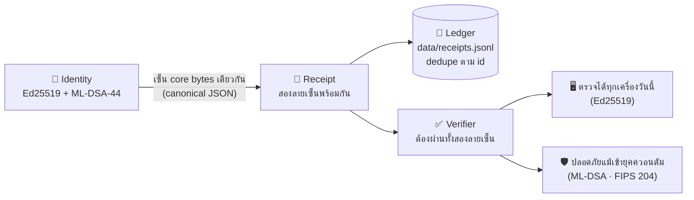

<div align="center">

### 🛡️ Sovereign PQ Identity
**POST-QUANTUM IDENTITY + DUAL-SIGNED RECEIPTS** — ตัวตนนิรนามที่ทำงานเครื่องใดก็ได้ **กุญแจเกิดและอยู่ในเครื่องคุณ · ตรวจได้ครบโดยไม่มีคลาวด์ทั้งชุด**

ร่วมกันแปลงสลิป/บันทึกออกเป็นลายเซ็น*สองชั้น* — **Ed25519** (ตรวจได้ทุกเครื่องวันนี้) + **ML-DSA-44 (FIPS 204)** (ลายเซ็นกันควอนตัมตามมาตรฐาน NIST) เครื่องอื่นตรวจย้อนได้เสมอ — ตั้งแต่ v1.4 เลือก **อัปเกรดชั้นที่สาม SLH-DSA (FIPS 205)** และ **หมุนเวียนกุญแจ** ได้ด้วยคำสั่งเดียว

[](https://nvlpubs.nist.gov/nistpubs/FIPS/NIST.FIPS.204.pdf)
[](https://nvlpubs.nist.gov/nistpubs/FIPS/NIST.FIPS.205.pdf)
[](https://nvlpubs.nist.gov/nistpubs/FIPS/NIST.FIPS.203.pdf)
[](.)
[](#-️-zk-snark-anonymous-proof-v12--พิสูจน์ว่าเป็นสมาชิกโดยไม่บอกว่าใคร)
[](#-ผลการทดสอบจากเครื่องจริง)
[](./package.json)

</div>

---

## 📜 ข้อปฏิบัติหลัก — ทะเบียนแผนและคิวนวัตกรรม ([PLAN.md](PLAN.md))

ทุกรอบการพัฒนาของ repo นี้ถูกบันทึกลง [PLAN.md](PLAN.md) — ทะเบียนแผนแบบ **append-only**: *เพิ่มได้ ห้ามลบรายการเดิม* เพื่อให้ทุกเวอร์ชัน (`REL-xx`) และทุกงานในคิว (`Q-xx`) มีที่มีประวัติที่โปร่งใส และทุกงานต้องประกาศชัดว่าจะ**ต่อยอดเข้าระบบหลัก [sovereign-origin](https://github.com/krisakornutama/sovereign-origin) ได้ตรงไหน** — กฎนี้ถูกตั้งเป็นข้อปฏิบัติหลักของ repo ตาม [AGENTS.md](AGENTS.md)

---

## ⚡ ติดตั้งและลองใน 2 นาที

```bash
git clone https://github.com/krisakornutama/sovereign-pq-identity.git
cd sovereign-pq-identity
npm install
node cli.js keygen "ชื่อเรียกเครื่อง"   # สร้างตัวตน + เก็บกุญแจใน Vault เข้ารหัส (ตั้ง passphrase ตอนถาม)
node cli.js keygen --slh "ชื่อ"        # แบบสามชั้น: เพิ่มลายเซ็น SLH-DSA-128s (FIPS 205) ตั้งแต่เกิดตัวตน
node cli.js demo        # จำลองขาย → ถอดกุญแจจาก vault → เซ็นตามโปรไฟล์ → ตรวจ → ลงคลัง
node cli.js selftest    # ทดสอบการบุกรุก 7 เคส (สลิป + vault)
npm test                # ชุดทดสอบเต็ม 48 เคส (ไม่ใช้เน็ต)

# หมุนเวียนกุญแจ (v1.4) — ตัวตนใหม่แทนชุดเดิม แล้วใบเสร็จเก่ายังตรวจผ่านทุกใบ
node cli.js rotate --slh           # หมุนครั้งเดียว + อัปเกรดเป็นสามชั้นพร้อมกัน (dual → triple)
node cli.js anchors                # สายสกุลกุญแจที่ปลดอายุแล้ว (กุญแจสาธารณะล้วน)
node cli.js rotate --if-due 90     # อายุตัวตนถึง 90 วันเมื่อไหร่ คำสั่งปกติครั้งถัดไปจึงหมุน (ยังไม่ถึง = exit 0 ไม่เขียนแฟ้ม)

# ZK-SNARK (v1.2–v1.3) — พิสูจน์กลุ่ม/ยอด โปรไฟล์ฐาน D=4 (16 ช่อง)
node cli.js zk enroll "กลุ่มซื้อฟาร์ม A"   # สมัครสมาชิก (กุญแจลับเข้า vault เข้ารหัสเท่านั้น)
node cli.js zk tree                        # รวมรากกลุ่ม → data/members_root.json
node cli.js zk prove "กลุ่มซื้อฟาร์ม A"    # สร้างใบพิสูจน์นิรนาม (nullifier กันใช้ซ้ำ)
node cli.js zk verify data/zk-receipt-<epoch>.json   # ฝั่งผู้ตรวจ: ใช้ vkey เท่านั้น ไม่แตะกุญแจ

node cli.js zk issue "แฟร์หลัก" 15600000     # ออกใบยอด 156,000.00 บาท (สตางค์) — ยอดเข้าคลังเข้ารหัสแฟ้มที่สอง
node cli.js zk balance-tree                  # รากใบยอด → data/balances_root.json (issuer ประกาศให้ผู้ตรวจ)
node cli.js zk prove-bal "แฟร์หลัก" 10000000 # พิสูจน์ "ยอด ≥ 100,000.00 บาท" → data/zk-balance-<epoch>.json
node cli.js zk verify-bal data/zk-balance-<epoch>.json  # ฝั่งผู้ตรวจ: ไม่รู้ใคร ไม่รู้ยอด แต่ยืนยันข้ออ้างได้

# ZK-SNARK (v1.5) — โปรไฟล์ลึก D=5 (32 ช่อง) + พิธีหลายฝ่าย
node cli.js zk tree --deep                   # รากโปรไฟล์ลึก D=5 → data/members_root.json (capacity: 32)
node cli.js zk prove "ชื่อ"                  # อ่านโปรไฟล์จากไฟล์รากอัตโนมัติ (D=4 หรือ D=5)
node cli.js zk verify data/zk-receipt-<epoch>.json   # เลือก vkey จาก field `circuit` ในใบเอง (membership_v1 / membership_d5_v1)

node cli.js zk balance-tree --deep           # รากใบยอดโปรไฟล์ลึก D=5
node cli.js zk prove-bal "ชื่อ" 10000000     # พิสูจน์ยอดโปรไฟล์ลึก (อ่านโปรไฟล์จากไฟล์ราก)
node cli.js zk verify-bal data/zk-balance-<epoch>.json # เลือก vkey จาก field `circuit` ในใบเอง (balance_v1 / balance_d5_v1)

# ML-KEM (v1.6) — ผนึกแฟ้มเป็นกล่องลงชื่อผู้รับเดียว (แฟ้มส่งระหว่างโหนด)
node cli.js kem keygen "โรงเรือนหลัก"        # เกิดกุญแจ ML-KEM-768 (sk เข้า vault เข้ารหัส · pk ลง data/kem-pub.json)
node cli.js kem seal report.json --to data/kem-pub.json   # ผู้ส่งใช้แต่กุญแจสาธารณะ — แฟ้มไปไหนก็ปลอดภัย
node cli.js kem open report.json.seal.json   # ปลายทางถือกุญแจลับในเครื่องเดียวที่ถือกุญแจนั้น (แก้ซอง 1 บิต = ปฏิเสธ)

# สายส่งมาตรฐาน (v1.7) — พิสูจน์แล้วผนึกในคำสั่งเดียว + โหนดขนส่งตรวจเส้นทางได้โดยไม่ต้องมีกุญแจ
node cli.js zk prove-bal "ชื่อ" 250000 --seal-to data/kem-pub.json   # พิสูจน์ยอดเสร็จ → ผนึกต่อทันที (ธงเดียวจบ)
node cli.js kem check report.json.seal.json             # metadata ล้วน: อัลกอริทึม/ผู้รับ/ขนาด — โหนดขนส่งใช้ได้
node cli.js kem check report.json.seal.json --match data/kem-pub.json   # โหนดปลายทางยืนยัน "ซองถึงฉันแหล่งที่ถูก"
```

**เอาต์พุตจริงตอนรัน `node cli.js demo` (คัดจากเครื่องที่สร้างระบบนี้เอง):**

```
สร้างใบเสร็จสาธิต + เซ็นสองลายเซ็นแล้ว
  ตัวตน     : sps_86889d83f2f32d7ef2a7  (sovereign.ed25519+ml_dsa44.v1)
  หมายเลขใบ: pqri_7f590bc1ae771ab6
  เวลา     : 2026-11-08T09:33:08.585Z
  ยอด      : ฿120.00
  บัญชีในเครื่อง: data/receipts.jsonl
  Ed25519   : ✓ ผ่าน
  ML-DSA-44 : ✓ ผ่าน
  สรุป      : ✓ ใบเสร็จถูกต้อง (ทั้งสองลายเซ็นตรวจผ่าน)
  (payload ทั้งหมดเป็นข้อมูลสาธิตในเครื่อง ไม่มีข้อมูลจริง)
```

---

## 💎 ทำอะไรได้บ้าง

| # | ระบบ | ทำหน้าที่อะไร |
|---|---|---|
| 🪪 | **ตัวตนนิรนาม (`sps_*`)** | สร้างคู่กุญแจ **Ed25519 + ML-DSA-44** แล้ว hash เป็นหมายเลขตัวตน (`sps_xxxx…`) — ไม่ผูกชื่อจริง อ้างธุรกรรมด้วยหมายเลขนี้เพียงอย่างเดียว |
| ✍️ | **ใบเสร็จสองลายเซ็น (`pqri_*`)** | bytes เดียวกันถูกเซ็นโดยกุญแจ 2 อัลกอริทึม — verify ต้องผ่าน **ทั้งคู่** ขาดตัวใดตัวหนึ่งถือว่าใบเสร็จไม่สมบูรณ์ |
| 🌐 | **ตรวจย้อนจากเครื่องอื่นได้** | bytes ที่ถูกเซ็นคือ canonical JSON (เรียงคีย์แบบเสถียร) — verifier อีกเครื่องคำนวณซ้ำแล้วได้ผลลัพธ์เดียวกันเสมอ |
| 💾 | **คลังใบเสร็จท้องถิ่น** | แฟ้ม JSONL + กันซ้ำตาม `id` (ยื่นใบเดิมซ้ำไม่เกิดรายการใหม่ — ระบบเดียวแบบ `sovereign-offgrid`) |
| 🔒 | **Domain separation** | ลายเซ็น ML-DSA ผูก context `"sovereign-pq-receipt/v1"` — ลายเซ็นจากระบบอื่นใช้ต่อในแฟ้มของระบบนี้ไม่ได้ |
| 🛡 | **Local Key Vault** | กุญแจ secret **ไม่เก็บ plaintext** — เก็บเป็น vault เข้ารหัส **Argon2id (RFC 9106) + AES-256-GCM** ถอดขึ้นหน่วยความจำเฉพาะตอนเซ็นสลิปเท่านั้น |
| 🕶️ | **ZK-SNARK กลุ่มสมาชิก (v1.2)** | พิสูจน์ "อยู่ในกลุ่มสมาชิกที่ลงทะเบียน" ต่อ POS/ผู้ตรวจด้วย **Groth16 + Poseidon Merkle + nullifier** — ผู้ตรวจไม่เห็นทั้งกุญแจและตำแหน่งในต้นไม้ ตรวจด้วย **vkey ล้วน** และกันใช้สิทธิ์ซ้ำรายคนต่อรอบ |
| 💰 | **ZK-SNARK ยอดเพียงพอ (v1.3)** | พิสูจน์ "**ยอด ≥ threshold ที่ผู้ตรวจประกาศ**" โดยไม่เปิดยอดจริง — ใบยอดออกโดย issuer ลงต้นไม้เดียวกัน (วงจร `balance.circom` ตรวจด้วย `LessEqThan(64)`) · ผู้ตรวจไม่รู้ใคร ไม่รู้ยอด กันใช้ซ้ำต่อใบต่อรอบและแยกโดเมนจากวงจรสมาชิกชัดเจน |
| 🔐 | **SLH-DSA ชั้นที่สาม (v1.4)** | โปรไฟล์ `--slh`: เซ็น bytes แกนเดิมด้วย **SLH-DSA-SHAKE-128s (FIPS 205)** — hash-based stateless ตามฉบับสมบูรณ์ของมาตรฐาน · verify ต้องผ่านครบ**ทุกชั้นของโปรไฟล์ใบนั้น** · โปรไฟล์สองชั้นเดิมไม่ถูกแตะ (ใบเก่าตรวจได้เหมือนเดิม) |
| 🔄 | **หมุนเวียนกุญแจ (v1.4)** | `rotate` เกิดตัวตนใหม่แทนชุดเดิม + ลง**สายสกุลกุญแจสาธารณะ** (`data/anchors.jsonl` — pk ล้วน ไม่มีกุญแจลับ) · ใบเสร็จเก่าทุกใบยังตรวจผ่าน เพราะกุญแจสาธารณะฝังในตัวใบเอง · `rotate --if-due <วัน>` หมุนเองเมื่อครบอายุ |

---

## 🚀 วิธีใช้งานครบชุด

```bash
# 1) สร้างตัวตนของเครื่องคุณ (กุญแจเกิดในเครื่องแล้วเก็บ vault เข้ารหัสทันที)
node cli.js keygen "ชื่อเรียกเครื่องนี้อย่างเดียว"

# 2) ออกใบเสร็จจำลอง + ตรวจทันที (เห็นกระบวนการเต็ม)
node cli.js demo

# 3) ตรวจแฟ้มใบเสร็จไฟล์ใดก็ได้ (exit 0 เมื่อผ่านครบทุกชั้นของโปรไฟล์)
node cli.js verify <แฟ้มใบเสร็จ.json>

# 4) อ่านคลังใบเสร็จในเครื่อง + ตรวจทีละใบ
node cli.js ledger

# 5) หมุนกุญแจก็ต่อเมื่ออยากหมุน (ตัวตนใหม่ ใบเก่าไม่พัง)
node cli.js rotate --slh     # หมุน + อัปเกรดสามชั้นในครั้งเดียว
node cli.js anchors          # ประวัติการหมุนทั้งหมด (สาธารณะล้วน)
```

**ใช้เป็นไลบรารีจากโค้ดคุณเอง:**

```js
import { createIdentity } from './src/identity.js';
import { signReceipt, verifyReceipt } from './src/receipt.js';

const identity = createIdentity({ label: 'แม่ค้าที่ 1' });      // สองชั้น (ค่าเริ่มต้น)
const triple   = createIdentity({ label: 'แม่ค้าที่ 1', withSlh: true }); // สองชั้น + SLH-DSA (v1.4)
const receipt = signReceipt(identity, { type: 'sale', total_thb: 210 });

// ใบเสร็จนี้ถูกเซ็นด้วย Ed25519 และ ML-DSA-44 — ใครถือแฟ้มก็ตรวจความจริงด้วยตัวเองได้
const v = verifyReceipt(receipt); // → { valid: true, ed25519: true, ml_dsa44: true }
```

**โครงใบเสร็จจริงในคลัง (ตัดความยาว base64 เพื่ออ่านง่าย — ความยาวในวงเล็บคือจำนวนจริง):**

```json
{
  "id": "pqri_7f590bc1ae771ab6",
  "issued_at": "2026-11-08T09:33:08.585Z",
  "payload": { "type": "sale", "demo": true, "total_thb": 120.0 },
  "alg_profile": "sovereign.ed25519+ml_dsa44.v1",
  "signatures": {
    "ed25519":  { "pk_b64": "…44 bytes SPKI (60 chars)", "sig_b64": "…64 bytes (88 chars)" },
    "ml_dsa44": { "pk_b64": "…1,312 bytes (1,750 chars)", "sig_b64": "…2,420 bytes (3,228 chars)" }
  }
}
```

---

## 🏛️ สถาปัตยกรรม — ทำไมต้อง "สองลายเซ็น"



**เหตุผลเชิงความเสี่ยง (Harvest-now-decrypt-later ที่มาคู่ใบเสร็จ):** สลิปที่เก็บไว้ยาว ๆ วันหนึ่งอาจถูกแกะ Ed25519 ได้ด้วยเครื่องควอนตัม — ถ้ายังใช้ลายเซ็นชั้นเดียว สลิปจะถูกปลอมแปลงภายหลังได้อย่างเงียบ ๆ ระบบสองลายเซ็นนี้จึงเป็นการเตือนความปลอดภัยตั้งแต่ต้นวันธุรกรรม — ทั้งยังตรวจย้อนระยะยาวได้เสมอ (ความยาวกุญแจตรงมาตรฐาน FIPS 204: pk = 1,312 bytes · sk = 2,560 bytes · sig = 2,420 bytes)

> 🧱 ตั้งแต่ v1.4 มีโปรไฟล์**สามชั้น** (เพิ่ม SLH-DSA · FIPS 205) ให้เลือกใช้ด้วยธง `--slh` — เหนียวกว่าเดิมอีกชั้น แลกกับลายเซ็นใหญ่และช้าขึ้น รายละเอียดอยู่หัวข้อ "🔐 SLH-DSA ชั้นที่สาม" ข้างล่าง

---

## 🔐 Local Key Vault — กุญแจไม่เก็บ plaintext อีกต่อไป

กุญแจ secret ถูกเข้ารหัสด้วย **Argon2id** (KDF กัน brute-force ตาม RFC 9106 · m=64 MiB t=3 p=1) → กุญแจ AES-256-GCM ปกป้องแฟ้ม vault — **passphrase ไม่ถูกเก็บที่ใดเลย** — ถอดกุญแจขึ้นหน่วยความจำชั่วคราวเฉพาะขณะเซ็นสลิปแล้วทิ้งพร้อมโปรแกรมปิด

```bash
# กรณีมีตัวตนแบบ plaintext เก่า (จาก v1.0) — migrate:
node cli.js vault create        # ย้ายกุญแจ → vault + ตรวจเปิดกลับก่อนสำเร็จ
node cli.js vault remove-plain   # ลบแฟ้ม plaintext (ตรวจว่า vault ยังเปิดได้ก่อนลบเสมอ)

# ทดสอบเปิด vault ได้จริง (ขึ้น public view เท่านั้น ไม่โชว์ secret)
node cli.js vault open
```

**เอาต์พุตจริงจากการ migrate บนเครื่องสร้างระบบ:**

```
$ node cli.js vault create
ย้ายกุญแจจากแฟ้ม plaintext → vault เข้ารหัส (แฟ้ม plaintext จะยังอยู่ จนสร้าง vault สำเร็จ)
✓ เตรียมเสร็จ: vault data/identity.vault.json ตรวจเปิดกลับผ่าน
  ✍ ต่อไป: ลบแฟ้ม plaintext เอง หรือ run: node cli.js vault remove-plain

$ node cli.js vault open
✓ เปิด vault ได้จริง (กุญแจอยู่ในหน่วยความจำเฉพาะกระบวนการนี้)
  ตัวตน : sps_86889d83f2f32d7ef2a7  ·  KDF: argon2id
  กุญแจ public: Ed25519 MCowBQYDK2Vw… / ML-DSA-44 Aq1AcVZ4+H8g…

$ node cli.js vault remove-plain
✓ ลบแฟ้ม plaintext แล้ว — กุญแจอยู่ใน vault เข้ารหัสเท่านั้น
```

**สิ่งพิสูจน์แล้วจากการทดสอบ 1 จุดดี ๆ:** หลังลบแฟ้ม plaintext ทิ้งแล้ว ใบเสร็จ**เก่า**ที่เคยเซ็นไว้ยังตรวจผ่าน ✓ ทุกใบ — เพราะกุญแจสาธารณะถูกฝังในตัวใบเสร็จเอง (ใครถือแฟ้มสลิปตรวจได้ตลอดอายุไฟล์ ไม่จำเป็นต้องถือกุญแจของผู้เซ็น)

> 💡 Automation ล้วน: กำหนด `SOVEREIGN_PASSPHRASE=...` (เฉพาะเซสชัน) แล้วคำสั่งทุกตัวไม่ถาม prompt — เหมาะ CI / สคริปต์เบื้องหลัง (ระวัง log แฟ้มประวัติคำสั่ง).

**ข้อแตกต่างตรวจสอบมาแล้วจากโค้ดจริง:**

- ปลอม payload แม้ 1 บิต → ทั้งสองลายเซ็นพังพร้อมกัน (bytes เดาไม่ได้)
- ลบลายเซ็น ML-DSA ออก → verify ปฏิเสธ (ไม่ยอมรับ Ed25519 เฉพาะ)
- สลับลายเซ็นจากใบอื่นมาแปะ → verify ปฏิเสธ (pk ต้องจับคู่ sk จริงของตัวเอง)
- เปลี่ยน `alg_profile` → canonical bytes เปลี่ยน → verify ปฏิเสธทันที

---

## 🕶️ ZK-SNARK Anonymous Proof (v1.2) — พิสูจน์ว่าเป็นสมาชิก โดยไม่บอกว่าใคร

รุ่น v1.2 เพิ่มระดับที่ลายเซ็นธรรมดาทำไม่ได้: ยืนยันต่อ POS/ผู้ตรวจว่า **"ผู้ถือสิทธิ์อยู่ในกลุ่มสมาชิกที่ลงทะเบียนไว้"** — โดยไม่เปิดเผยกุญแจ ไม่เปิดเผยตำแหน่งในต้นไม้สมาชิก และไม่เกิดการใช้สิทธิ์ซ้ำ

**วงจรจริง:** `circuits/membership.circom` — Groth16 บนเส้นโค้ง **BN254** · แฮชแผนผังทั้งหมดด้วย **Poseidon**(circomlib — SNARK-friendly) · ความลึก D=4 → ความจุ 16 สมาชิก · คอมไพล์จาก circom 2.2.3 → **1,592 non-linear + 2,054 linear constraints**

| ตัวแปรของวงจร | ฝั่งจากใคร | ผู้ตรวจเห็นได้เหลือเกิน |
|---|---|---|
| `identitySecret` · `pathElements[4]` · `pathIndices[4]` | **private** — อยู่ในหน่วยความจำเครื่องผู้พิสูจน์เท่านั้น | ✗ ไม่เห็นเลย |
| `merkleRoot` (รากทะเบียนกุมสิทธิ์) · `epochNonce` (หมายเลขรอบ กัน replay) | **public input** | ✓ เห็น |
| `nullifierHash` = Poseidon(`identitySecret`, `epochNonce`, TAG_NULL) | **output สาธารณะ** | ✓ เห็น — รู้ว่า "สิทธิถูกใช้แล้ว" แต่ไม่รู้ว่าใคร |

การแยกหน้าที่ชัดกันทุกขั้นด้วยแท็กโดเมน (LEAF / NODE / NULL) — แฮชจากขั้นหนึ่งถ่ายไปแทนอีกขั้นไม่ได้ · **nullifier ทำหน้าที่กัน double-claim**: ใบเดียวกันในรอบเดียวกัน (epoch) ยื่นซ้ำจะถูกจากคลัง nullifier ฝั่งผู้ตรวจ

**เอาต์พุตจริงจาก CLI บนเครื่องสร้างระบบ (กระบวนการครบวงจร):**

```
$ node cli.js zk enroll "กลุ่มซื้อฟาร์ม A"
✓ คลังสมาชิกสร้างใหม่ (เข้ารหัสแบบเดียวกับกุญแจตัวตน: Argon2id + AES-256-GCM)
✓ ลงทะเบียนสมาชิก "กลุ่มซื้อฟาร์ม A" สำเร็จ (อันดับ 0)
  commitment (สาธารณะ): 0x260144f1c5a70db9a035…
  (กุญแจลับอยู่ใน data/membership.vault.json — แฟ้มทะเบียนไม่มีข้อมูลลับ)

$ node cli.js zk tree
✓ รากสมาชิก (merkleRoot): 0xd5a49d1c5d9a69affd9a2e63…
  สมาชิก 2 จากความจุสูงสุด 16 (ช่องว่างเติมด้วยค่า 0 ครบทุกชั้น …)

$ node cli.js zk prove "กลุ่มซื้อฟาร์ม B"
พิสูจน์นิรนาม (กุญแจลับอยู่ในหน่วยความจำระหว่างคำนวณเท่านั้น)…
✓ พิสูจน์สำเร็จ → data/zk-receipt-20261109.json
  ใบพิสูจน์  : pqri_anon_255f9900  ·  epoch: 20261109
  nullifier : 0x255f99001e8e1dcc…  (ผู้ตรวจบันทึกไว้กันซ้ำ — ไม่ออกตัวตน)
  ราก       : 0xd5a49d1c5d9a69af…

$ node cli.js zk verify data/zk-receipt-20261109.json
✓ ใบพิสูจน์ถูกต้อง (vkey ตรวจผ่าน · กุญแจเจ้าของไม่ถูกเปิดเผย)
  nullifier : 0x255f99001e8e1dcc…  → บันทึกกันซ้ำแล้ว (0 รายการ)
  margin: ใบเดียวกันรอบเดียวกันใช้ซ้ำไม่ได้อีก — epoch ใหม่คือสิทธิ์ใหม่

$ node cli.js zk verify data/zk-receipt-20261109.json     # ยื่นซ้ำ
✗ สิทธิ์รอบนี้ถูกใช้ไปแล้ว (nullifier ซ้ำ) — ปฏิเสธแม้ proof ยังถูกต้องตามวงจร   (exit 1)
```

**ขั้นพิสูจน์จริงที่ไม่มีข้อมูลจำลอง:** prove โดยไม่มีกุญแจจาก vault ไม่ได้ผล (CLI ตรวจซ้ำว่า hash ของกุญแจ secret ตรง commitment ที่ลงทะเบียนไว้ก่อนลงมือพิสูจน์เสมอ) · แก้ `pi_c` 1 ค่า → verify false · กุญแจปลอม → วงจรปฏิเสธตั้งแต่ทำ witness · ตรวจย้อนข้ามเครื่องทั่วไปด้วยคำสั่งมาตรฐาน: `npx snarkjs groth16 verify artifacts/membership_vkey.json <public.json> <proof.json>` → `OK!`

**การใช้แฟ้มวงจร**: ชุดที่ใช้แล้วบันทึกไว้ใน `artifacts/` ทั้งหมด (**`membership.wasm` 1.86 MB · `membership.zkey` 1.50 MB · `membership_vkey.json` 3.2 KB** และชุด balance ด้านล่าง) — ฝั่งผู้พิสูจน์ใช้ wasm+zkey ฝั่งผู้ตรวจต้องมี **vkey เท่านั้น** (ไม่ต้องมี zkey ไม่ต้องมีกุญแจสมาชิก)

### การสร้างแฟ้มวงจร (เมื่อต้องการออกวงจรใหม่หรือกลุ่มใหญ่ขึ้น — ทำครั้งเดียวต่อวงจร)

```bash
# คอมไพล์วงจร (circom v2.2.3 — ดาวน์โหลด binary จาก release ของ iden3/circom ไว้ .tools/)
.tools/circom.exe circuits/membership.circom --wasm --r1cs -o build -l node_modules

# Powers of Tau + Groth16 setup — entropy มาจากตัวเครื่องเราเองทั้งหมด (ไม่โหลดจากที่ไหน)
npx snarkjs powersoftau new bn128 14 build/pot14_0000.ptau -v
npx snarkjs powersoftau contribute build/pot14_0000.ptau build/pot14_0001.ptau --name="local" -v -e="<ข้อความสุ่มยาวของเครื่องนี้ — ไหมทำเป็นหมายเลขประจำตัวที่จดไว้/เปิดเผย>"
npx snarkjs powersoftau prepare phase2 build/pot14_0001.ptau build/pot14_final.ptau -v
npx snarkjs powersoftau verify build/pot14_final.ptau               # → "Powers of Tau Ok!"
npx snarkjs groth16 setup build/membership.r1cs build/pot14_final.ptau build/membership_0000.zkey
npx snarkjs zkey contribute build/membership_0000.zkey build/membership_final.zkey --name="local" -v -e="<ข้อความสุ่มอีกชุด>"
npx snarkjs zkey verify build/membership.r1cs build/pot14_final.ptau build/membership_final.zkey   # → "ZKey Ok!"
npx snarkjs zkey export verificationkey build/membership_final.zkey artifacts/membership_vkey.json

# ทำแฟ้มให้ artifacts/ (ผู้ตรวจถูกต้องด้วย vkey; ใน repo นี้แนบชุดให้แล้ว)
cp build/membership_js/membership.wasm artifacts/membership.wasm
cp build/membership_final.zkey artifacts/membership.zkey
```

### ข้อจำกัดที่ควรรู้ก่อนพาไปใช้จริง (ตามความจริง)

- ⚙️ **Trusted setup ครั้งเดียวแบบฝ่ายเดียว** — powersoftau/zkey ของ repo นี้สร้างในเครื่องเดียว (entropy ในเครื่องล้วน) ทุกเครื่องตรวจได้เพราะมี vkey กับรากเดียวกัน แต่การเชื่อว่า zkey ไม่มี "ปีกความรู้ข้างเครื่องสร้าง" คือความเชื่อมั่นที่พึงถือเครื่องสร้าง; สำหรับระบบสาธารณะเต็มจริงแค่บัญชีส่วนท้ายต้องทำ ceremony หลายฝ่าย — นี่คือจุดแชร์เปิดศักดิ์สิทธิ์อย่างตรงไปตรงมา
- 🧮 **ความจุกลุ่ม 16 สมาชิกต่อใบราก** (D=4) — กลุ่มใหญ่ขึ้นต้องออกวงจรลึกขึ้น (D=5 → 32 คน) และ generate/setup ใหม่ทั้งชุด; ช่องว่างใบตองด้วย 0 — ปลอมพิสูจน์ด้วยช่องว่างไม่ได้เพราะวงจรสร้าง leaf จาก `identitySecret` ตลอด (หักหลังกลับค่า 0 ผ่าน hash preimage ถือว่าไม่เอาอย่างเข้มขัดกว่าการปลอมกุญแจแบบทั่วไป) 
- 📅 **1 คน = 1 สิทธิ์ / 1 epoch** — คลัง nullifier ที่ `data/nullifiers.jsonl` เก็บฝั่งผู้ตรวจ (ลำดับ event log) · ยากแต่ควรเป็นอนัมภัย: ผู้ตรวจควร pin แฟ้มรากตามวัน (`data/members_root.json มี`generated_at`) — รากใหม่เมื่อกลุ่มเปลี่ยน· สิทธิ์ใบแถวยังตรวจกับรากตาม epoch ที่ประกาศไว้อย่างเห็น
- 🐢 **snarkjs คืน worker ไว้ใน event loop** — หลัง prove/verify จริงเนื่องภายในไฟล์ต่อเนื่องจะยังย่านว่าถึงกระบวนจบเร็ว ๆ แต่ในขั้นของ "ชุดลงทุนทดสอบ" รวม `npm test` รันด้วย `--test-force-exit` (built-in Node ≥22.8) เพื่อบังคับจบให้ผลครบ — หลักเตลิดตามทุกคำสั่ง CLI ที่ทำงาน prove/verify สั่ง `process.exit()` หลังเขียนแฟ้มเสร็จ

---

## 💰 ZK-SNARK Balance Threshold Proof (v1.3) — พิสูจน์ว่ายอดเพียงพอ โดยไม่บอกยอด

รุ่น v1.3 เพิ่มวงจรที่ 2 บนโครงเดียวกับ membership ทั้งชุด (Groth16 · Poseidon Merkle · nullifier): issuer ออก "ใบยอด" ลงต้นไม้ → ผู้ถือพิสูจน์ต่อผู้ตรวจว่า **"ยอดของใบนี้ ≥ threshold ที่ผู้ตรวจประกาศ"** — ผู้ตรวจไม่เห็นทั้งตัวตนผู้ถือและเลขยอดจริง

**วงจรจริง:** `circuits/balance.circom` — คอมไพล์จาก circom 2.2.3 → **1,657 non-linear + 2,058 linear constraints** · ข้ออ้างหลักตรวจในวงจรด้วย `LessEqThan(64)` (จาก circomlib comparators — ผ่าน `Num2Bits(65)` ที่มาผูกช่วง 64 บิตของยอดควบคู่ไปด้วย) · leaf = Poseidon(balance, blinding, TAG_BAL=10) · node = Poseidon(L, R, TAG_NODE=0) เดียวกับสมาชิกเป๊ะ

| ตัวแปรของวงจร | ฝั่งจากใคร | ผู้ตรวจเห็นได้เหลือเกิน |
|---|---|---|
| `balance` (สตางค์ 64 บิต) · `blinding` · `pathElements[4]` · `pathIndices[4]` | **private** — ยอดจริงไม่ออกจากเครื่องผู้พิสูจน์ | ✗ ไม่เห็นเลย |
| `merkleRoot` (รากใบยอดที่ issuer ปิน) · `epochNonce` · `threshold` (ขั้นต่ำที่ประกาศ) | **public input** | ✓ เห็น |
| `nullifierHash` = Poseidon(blinding, epoch, TAG_NULL_BAL=11) | **output สาธารณะ** | ✓ เห็น — จับใช้ซ้ำได้ แต่ดึงยอด/ตัวตนกลับไม่ได้ |

แท็กโดเมน **10/11 เหลื่อมจากวงจรสมาชิก (1/2) โดยเจตนา** — ใบยอดกับ nullifier ยอดไม่มีทางทับค่าของวงจรอื่น (ทดสอบแยกโดเมนชัดในชุดเทส) · ยอดต่ำกว่า threshold วงจร**ปฏิเสธตั้งแต่คำนวณ witness** — ไม่มี proof ออกมาให้หลอก

**เอาต์พุตจริงจาก CLI บนเครื่องสร้างระบบ (กระบวนการครบวงจร — ยอดหน่วยสตางค์):**

```
$ node cli.js zk issue "แฟร์หลัก" 15600000      # 156,000.00 บาท
✓ คลังใบยอดสร้างใหม่ (เข้ารหัส Argon2id + AES-256-GCM — แยกจากคลังสมาชิก)
✓ ออกใบยอด "แฟร์หลัก" สำเร็จ (ใบยอดที่ 0)
  commitment (สาธารณะ): 0x271dc56eb24f215dc5e9…
  (ทะเบียนไม่มีตัวเลขยอด — ยอดจริง + เหลื่อมสุ่มอยู่ใน data/balances.vault.json เข้ารหัสเท่านั้น)

$ node cli.js zk issue "แฟร์ดอกไม้" 3000000     # 30,000.00 บาท
✓ ออกใบยอด "แฟร์ดอกไม้" สำเร็จ (ใบยอดที่ 1)
  commitment (สาธารณะ): 0xc87fa136d2ec9b2266b8…

$ node cli.js zk issue-list
ทะเบียนใบยอด 2/16:
  [ใบยอดที่ 0]  commitment: 0x271dc56eb24f215dc5e9…
  [ใบยอดที่ 1]  commitment: 0xc87fa136d2ec9b2266b8…

$ node cli.js zk balance-tree
✓ รากใบยอด (merkleRoot): 0xd01e2c338813774a7d2a191d…
  2 ใบจากความจุ 16 (ช่องว่างเติมด้วยค่า 0 ครบทุกชั้น)

$ node cli.js zk prove-bal "แฟร์หลัก" 10000000
พิสูจน์ "ยอด ≥ 10000000 สตางค์" (ยอดจริงอยู่ในวงจรเท่านั้น ไม่กลายเป็นข้อมูลสาธารณะ)…
✓ พิสูจน์สำเร็จ → data/zk-balance-20261109.json
  ใบพิสูจน์  : pqri_thr_638c0f42  ·  ข้ออ้าง: ยอด ≥ 10000000 สตางค์  ·  epoch: 20261109
  nullifier : 0x638c0f42f946278e…  (ผู้ตรวจบันทึก — ไม่รู้ว่าใคร ไม่รู้ยอด)
  ราก       : 0xd01e2c338813774a…

$ node cli.js zk prove-bal "แฟร์ดอกไม้" 10000000    # ยอดจริง 3,000,000 สตางค์ < ขั้นต่ำ
✗ ยอดของ "แฟร์ดอกไม้" ต่ำกว่า threshold ที่ประกาศ (10000000 สตางค์) — วงจรไม่ยอมพิสูจน์ข้ออ้างลวง   (exit 1)

$ node cli.js zk verify-bal data/zk-balance-20261109.json
✓ ใบพิสูจน์ยอดถูกต้อง (vkey ตรวจผ่าน · ทั้งตัวตนและยอดจริงไม่ถูกเปิดเผย)
  ข้ออ้าง    : ยอด ≥ 10000000 สตางค์ (มัดจำใน proof เท่านั้น)
  nullifier : 0x638c0f42f946278e…  → บันทึกกันซ้ำแล้ว (1 รายการ)

$ node cli.js zk verify-bal data/zk-balance-20261109.json    # ยื่นซ้ำ
✗ สิทธิ์ยอดรอบนี้ถูกใช้ไปแล้ว (nullifier ซ้ำ) — ปฏิเสธแม้ proof ยังถูกต้องตามวงจร   (exit 1)

$ node cli.js zk verify data/zk-balance-20261109.json        # ส่งใบยอดไปที่เครื่องตรวจวงจรสมาชิก
แฟ้มไม่ใช่ใบพิสูจน์ ZK วงจร membership ของระบบนี้   (exit 1)
```

**โครงใบพิสูจน์จริง (ตัด proof ยาว — publicSignals คือสิ่งเดียวที่ส่งผู้ตรวจ):**

```json
{
  "receiptId": "pqri_thr_638c0f42",
  "authMode": "zk-snark-groth16",
  "circuit": "balance_v1",
  "threshold": "10000000",
  "zkProof": { "pi_a": ["…"], "pi_b": [["…"]], "pi_c": ["…"] },
  "publicSignals": {
    "merkleRoot": "0xd01e2c338813774a7d2a191d…",
    "nullifierHash": "0x638c0f42f946278e…",
    "epochNonce": "20261109",
    "threshold": "10000000"
  }
}
```

**ข้อจำกัดของวงจรที่ 2 (ตามความจริง):**

- 📌 **issuer ต้องปินราก** — `data/balances_root.json` คือข้อตกลงเดียวระหว่าง issuer กับผู้ตรวจ ออกใบใหม่หลังปิน = รากใหม่ ต้องประกาศใหม่ให้ผู้ตรวจทุกครั้ง (ใบนอกรากที่ผู้ตรวจถือ = ปฏิเสธแน่นอน)
- 🪙 **หน่วยเป็นสตางค์และจำกัด 64 บิต** — สูงสุด 18,446,744,073,709,551,615 สตางค์ต่อใบ (≈ ฿184 ล้านสี่ร้อยล้าน) ป้อนเกินช่วง CLI ปฏิเสธก่อนถึงวงจร
- 🧮 **ความจุ 16 ใบต่อราก** (ลึกเท่าวงจรสมาชิก D=4) — ใบเกินต้องออกวงจรลึกขึ้นและ setup ใหม่ทั้งชุด
- 🗂 **คลัง nullifier เดียวกัน สองโดเมน** — `data/nullifiers.jsonl` รวมทั้งสองวงจร (ระบุ `circuit` ในแต่ละรายการ) ค่า nullifier ต่างวงจรมาจากโดเมนต่างกัน (แท็ก 2/11) จึงไม่ปนกัน
- 🔁 **1 ใบ = 1 สิทธิ์ / 1 epoch** — ใบต่างกัน (ยอดต่างกัน) แยกสิทธิ์ได้อิสระ แต่ใบเดียวยื่นซ้ำรอบเดิมได้รายการเดียว

## 🔐 SLH-DSA ชั้นที่สาม + หมุนเวียนกุญแจ (v1.4) — เสริมเกราะ แล้วหมุนกุญแจได้โดยใบเก่าไม่ตาย

รุ่น v1.4 **ไม่บังคับให้ทุกใบอ้วนขึ้น** — เลือกได้ผ่านโปรไฟล์ลายเซ็น: สองชั้นยังเป็นค่าเริ่มต้น (ใบเก่าทุกใบตรวจได้เหมือนเดิมทั้งหมด) และสามชั้นเปิดเมื่อต้องการ:

| โปรไฟล์ | alg_profile | ชั้นลายเซ็น | ขนาดแฟ้มใบ (วัดจริงจากเดโม) | เปิดใช้ด้วย |
|---|---|---|---|---|
| **สองชั้น** (ค่าเริ่มต้น · v1.0) | `sovereign.ed25519+ml_dsa44.v1` | Ed25519 + ML-DSA-44 (FIPS 204) | ~5.6 KB/ใบ | `keygen` |
| **สามชั้น** (v1.4) | `sovereign.ed25519+ml_dsa44+slh_dsa128s.v1` | + SLH-DSA-SHAKE-128s (FIPS 205) | ~16.1 KB/ใบ | `keygen --slh` หรือ `rotate --slh` |

**ทำไมเลือก SLH-DSA-SHAKE-128s แทน Falcon:** ทั้งคู่มีอยู่ใน `@noble/post-quantum` แต่ **FIPS 206 (Falcon) ยังเป็นฉบับร่าง** — ระบบนี้จึงหยิบที่จบมาใช้ก่อน: FIPS 205 ปิดตัวเป็นมาตรฐานแล้ว และความเชื่อมั่นของ SLH-DSA ยืนบน **ฟังก์ชันแฮชมาตรฐานล้วน (SHAKE-128) แบบ stateless** — อนุรักษ์นิยมที่สุดในอัลกอริทึมกันควอนตัม เมื่อไหร่ FIPS 206 finalize เพิ่มเป็นโปรไฟล์อื่นได้ตามโรดแม็ป

จุดรวมของโปรไฟล์สามชั้น:

- หมายเลขตัวตน = hash ของกุญแจสาธารณะ**ทุกดอกในโปรไฟล์** — เพิ่ม SLH เข้าไป id **ต่างจากสองชั้นแน่นอน** (สองตัวตนแยกตั้งแต่กำเนิด)
- ลายเซ็น SLH ผูก context เดียวกับ ML-DSA: `sovereign-pq-receipt/v1` — การยืมลายเซ็นจากระบบอื่นมาแปะในแฟ้มของระบบนี้ไม่มีทางสำเร็จ
- verify **ไล่ตามโปรไฟล์ของใบ** — ใบสามชั้นขาดลายเซ็น SLH = **ใบไม่สมบูรณ์** ปฏิเสธทันที · ใบสองชั้นตรวจเหมือนเดิมเป๊ะ
- โหลด vault ตรวจความยาวกุญแจทุกชั้นตามโปรไฟล์ก่อนใช้เสมอ — SLH pk 32 B · sk 64 B (sk เก็บใน vault เข้ารหัสเหมือนกุญแจชั้นอื่น)

**การหมุนกุญแจ (`rotate`) — หมุนได้เพราะใบเสร็จยืนด้วยตัวเอง:**

- `rotate` เกิดกุญแจใหม่แทนชุดเดิม (label คงเดิม) แล้ว**เขียนทับ vault** — passphrase คงเดิมใช้ต่อได้ (กฎ "ลืม = กู้ไม่ได้" เหมือนเดิม)
- กุญแจเก่าถูกปลดอายุลง**สายสกุลกุญแจสาธารณะ** `data/anchors.jsonl` (JSONL เติมท้ายเสมอ — pk ล้วน ไม่มีกุญแจลับสักจุด)
- **ใบเสร็จเก่ายังตรวจผ่านทุกใบ** — pk ฝังคู่ลายเซ็นในใบตั้งแต่ v1.0 หมุนวันไหนก็ได้ ไม่ทำให้สลิปเก่าใช้ไม่ได้
- `rotate --if-due <วัน>` = เกตหมุนอัตโนมัติ — อายุไม่ถึง: พิมพ์บอกแล้ว **exit 0 ไม่เขียนแฟ้มใด** ครอบด้วย scheduler ภายนอกได้ทันที (passphrase ผ่าน env)

**เอาต์พุตจริง — เส้นทางอัปเกรดเต็มวงจร (สองชั้น → สามชั้น) จากเครื่องสร้างระบบ:**

```
$ node cli.js keygen "ห้างทดสอบ"                      # ค่าเริ่มต้น = สองชั้น
สร้างกุญแจคู่ Ed25519 + ML-DSA-44 แล้วเก็บเข้า Vault เข้ารหัส  (อยากได้ชั้นที่สาม: เพิ่ม --slh)
(จำ passphrase ให้ดี — ลืมแล้วอ่านกุญแจกลับไม่ได้)
✓ กุญแจสร้างเสร็จ + เก็บใน vault: data/identity.vault.json
  หมายเลขตัวตนนิรนาม: sps_7a0d3e59328cd065a905  (ไม่ผูกชื่อจริง — อ้างหมายเลขนี้อย่างเดียว)
  โปรไฟล์ลายเซ็น: sovereign.ed25519+ml_dsa44.v1
  KDF: Argon2id {"m":65536,"t":3,"p":1}
  ⚠ passphrase ไม่ถูกบันทึกที่ไหน: ลืม = ไม่มีทางกู้คืน

$ node cli.js demo                                    # ออกใบสมัยกุญแจเดิม (สองชั้น)
สร้างใบเสร็จสาธิต + เซ็นสองลายเซ็นแล้ว (กุญแจถอดออกจาก vault ในหน่วยความจำเท่านั้น)
  ตัวตน     : sps_7a0d3e59328cd065a905 (sovereign.ed25519+ml_dsa44.v1)
  หมายเลขใบ: pqri_d718f763d80a3ed4
  เวลา     : 2026-11-09T13:19:49.833Z
  ยอด      : ฿120.00
  คลังในเครื่อง: data/receipts.jsonl
  Ed25519   : ✓ ผ่าน
  ML-DSA-44 : ✓ ผ่าน
  สรุป      : ✓ ใบเสร็จถูกต้อง (ทั้งสองลายเซ็นตรวจผ่าน)
  (payload ทั้งหมดเป็นข้อมูลสาธิตในเครื่อง ไม่มีข้อมูลจริง)

$ node cli.js rotate --slh                            # หมุนกุญแจ + อัปเกรดสามชั้นพร้อมกัน
✓ หมุนกุญแจสำเร็จ — ตัวตนใหม่: sps_f71e1e9e365abd17c007
  สายสกุล   : sps_7a0d3e59328cd065a905 → sps_f71e1e9e365abd17c007  (ลง data/anchors.jsonl แล้ว — กุญแจสาธารณะที่ปลดอายุเท่านั้น ไม่มีกุญแจลับ)
  โปรไฟล์  : sovereign.ed25519+ml_dsa44.v1 → sovereign.ed25519+ml_dsa44+slh_dsa128s.v1  (อัปเกรดเพิ่มชั้น SLH-DSA)
  ใบเสร็จเก่าทุกใบยังตรวจผ่านได้ตามเดิม — ตรวจสอบอยู่ในตัวใบเสร็จเอง (pk ฝังคู่ลายเซ็น)
  ระวังจุดเปลี่ยน: คำสั่งที่ถอด vault ต่อจากนี้ใช้ passphrase เดิมกับกุญแจใหม่ทั้งชุด

$ node cli.js verify data/receipt-before-upgrade.json # ใบสมัยกุญแจเดิม — หลังหมุนแล้ว
  Ed25519   : ✓ ผ่าน
  ML-DSA-44 : ✓ ผ่าน
  สรุป      : ✓ ใบเสร็จถูกต้อง (ทั้งสองลายเซ็นตรวจผ่าน)          ← back-compat 100%

$ node cli.js anchors                                 # สายสกุลกุญแจที่ปลดอายุแล้ว
สายสกุลกุญแจ (ทุกชุดปลดอายุแล้ว — สาธารณะล้วน):
  [0] sps_7a0d3e59328cd065a905 → sps_f71e1e9e365abd17c007  sovereign.ed25519+ml_dsa44.v1 → sovereign.ed25519+ml_dsa44+slh_dsa128s.v1
      ใช้งานระยะ: 2026-11-09T13:19:41.609Z → 2026-11-09T13:20:05.523Z  (rotate)
  ใบเสร็จที่ออกสมัยกุญแจเก่า: ตรวจได้ตลอดอายุแฟ้ม — pk ฝังในตัวใบเสร็จเอง

$ node cli.js demo                                    # ออกใบใหม่ด้วยตัวตนที่หมุนแล้ว
สร้างใบเสร็จสาธิต + เซ็นสามลายเซ็นแล้ว (กุญแจถอดออกจาก vault ในหน่วยความจำเท่านั้น)
  ตัวตน     : sps_f71e1e9e365abd17c007 (sovereign.ed25519+ml_dsa44+slh_dsa128s.v1)
  หมายเลขใบ: pqri_f47fe048b8a446b8
  เวลา     : 2026-11-09T13:20:24.914Z
  ยอด      : ฿120.00
  คลังในเครื่อง: data/receipts.jsonl
  Ed25519   : ✓ ผ่าน
  ML-DSA-44 : ✓ ผ่าน
  SLH-DSA   : ✓ ผ่าน
  สรุป      : ✓ ใบเสร็จถูกต้อง (ลายเซ็นครบสามชั้นตรวจผ่าน)
  (payload ทั้งหมดเป็นข้อมูลสาธิตในเครื่อง ไม่มีข้อมูลจริง)

$ node cli.js ledger                                  # คลังเดียวกัน — ใบเก่า/ใหม่ตรวจได้ทุกใบ
คลังในเครื่องมี 2 ใบ:
  pqri_d718f763d80a3ed4  9/11/2569 20:19:49  ฿120.00  ✓
  pqri_f47fe048b8a446b8  9/11/2569 20:20:24  ฿120.00  ✓

$ node cli.js rotate --if-due 90                      # เกตอายุ — ยังไม่ครบ 90 วัน
✓ ยังไม่ถึงกำหนด — ตัวตน sps_f71e1e9e365abd17c007 อายุ 0 วัน < 90 วัน ไม่เขียนแฟ้มใด
  (automation: กำหนด SOVEREIGN_PASSPHRASE แล้วข้ามวันครบกำหนดครั้งต่อไปจะหมุนโดยไม่ถาม)   (exit 0)
```

**ตัวเลขวัดจริงบนเครื่องทดสอบ (Node.js 24 · JS ล้วน — วัดด้วยสคริปต์สั้น ๆ บน `@noble/post-quantum` ตรง ๆ):**

| ขั้น | ML-DSA-44 (FIPS 204) | SLH-DSA-SHAKE-128s (FIPS 205) |
|---|---|---|
| keygen | 26 ms | ~2.9 s |
| sign | 24 ms | **~22 s** (วัด 21.9 s) |
| verify | 4 ms | 24 ms |
| ขนาดลายเซ็น | 2,420 B | 7,856 B |
| ขนาดกุญแจสาธารณะ | 1,312 B | 32 B |

```
keygen_ms=2895 sign_ms=21899 verify_ms=24 sig_bytes=7856 pk_bytes=32 ok=true   ← SLH-DSA
keygen_ms=26 sign_ms=24 verify_ms=4 sig_bytes=2420 pk_bytes=1312 ok=true       ← ML-DSA-44
```

**ข้อจำกัดของ v1.4 ที่ควรรู้ก่อนใช้ (ตามความจริง):**

- 🐌 **เซ็นชั้น SLH ~22–25 วินาทีต่อใบ** ใน JS ล้วน (ส่วนตรวจเร็ว — 24 ms) — เหมาะกับใบที่ขึ้นราคาหรืออายุยาวจนคุ้มการรอ ไม่เหมาะกับสลิปถี่ (ออกเป็นสิบใบต่อชั่วโมง); ทางเร่งคือสลับมาใช้ WASM ในฉบับถัดไป (พอร์ตง่าย — API เดียวกัน)
- 📦 **ใบสามชั้น ~16.1 KB ต่อใบ** (ด้วยลายเซ็น SLH 7,856 B ≈ 10.5 KB เมื่อ base64) — เทียบสองชั้น ~5.6 KB; การส่งผ่าน QR ไม่พอ ต้องส่งเป็นแฟ้ม/URL
- 🤖 **อัตโนมัติคือธง `--if-due` เท่านั้น** — ไม่มี daemon/ตารางเวลาในตัวระบบ (แนวนโยบาย zero-cloud ของโครงการ) ครอบด้วย Task Scheduler/cron ภายนอกผ่าน env passphrase ได้ทันที
- 🔗 **สายสกุล `data/anchors.jsonl` เป็นของสาธารณะล้วน** — โครงในแฟ้ม: `id_old/id_new` + กุญแจสาธารณะชุดปลดอายุ + ช่วงเวลาใช้งาน (ไม่มีลายเซ็นข้ามรายการ — เป็นบันทึกประวัติ ไม่ใช่หลักฐานผูกพันในตัวเอง) · แฟ้มนี้ยังอยู่ใน `data/` นอก git เหมือนเดิม
- 🔑 **หมุนแล้วไม่มีทางย้อนกลับ** — กุญแจเก่าแยกไปจาก vault เมื่อหมุนเสร็จ ระบบไม่เตรียมสำรอง sk ไว้เลย (ใบเก่าตรวจได้เพราะ pk ในใบ ไม่ต้องใช้ sk เดิม) · ใบใหม่ทุกใบเซ็นด้วยกุญแจใหม่เสมอ

---

## 🎪 ZK-SNARK โปรไฟล์ลึก D=5 + พิธีหลายฝ่าย (v1.5) — กลุ่ม 32 ช่อง · ใบยอด 32 ใบ · โซ่เชื่อมั่น 3 สาย

รุ่น v1.5 ขยายความจุกลุ่มจาก 16 → **32 ช่อง/ราก** (D=4 → D=5) และนำเสนอ **พิธี Groth16 หลายฝ่าย (multi-party ceremony chain)** แบบโปร่งใส — ทั้งหมดทำในเครื่องเดียว (สาธิตโครงสาย) แต่โครงรองรับผู้ร่วมจริง (ต่างเครื่อง) ได้ทุกจุด

### 🔄 พิธีหลายฝ่าย (Ceremony Chain ×2 วงจร) — เอาต์พุตจริงจากเครื่องสร้างระบบ

```bash
# โปรไฟล์ลึก D=5 — ทั้ง membership และ balance ใช้ pot14 เดิม (รีไซเคิล — ไม่ทำ Powers of Tau ใหม่)
node scripts/ceremony.mjs
```

**สายพิธีต่อวงจร (chain 3 ขั้นต่อฝ่าย):**

```
groth16 setup (ฐานจาก pot14)  →  zkey contribute [local-a]  →  zkey contribute [local-b]  →  zkey verify (ZKey Ok!)  →  export vkey
```

| วงจร | Constraints | ZKey (bytes) | WASM (bytes) | VKey (bytes) | เวลาพิธี |
|---|---|---|---|---|---|
| **membership_d5** (D=5, 32 ช่อง) | 4,255 | 2,054,018 B (~2.0 MB) | 1,858,976 B (~1.8 MB) | 3,542 B | ~16.2 s |
| **balance_d5** (D=5, 32 ใบ) | 4,324 | 2,084,722 B (~2.1 MB) | 1,861,964 B (~1.8 MB) | 3,740 B | ~16.2 s |

**เปรียบเทียบ D=4 → D=5 (ขนาด artifacts เพิ่ม ~×1.3–1.4):**

| | D=4 (ฐาน) | D=5 (ลึก v1.5) |
|---|---|---|
| membership zkey | 1,572,831 B | 2,054,018 B (+31%) |
| membership wasm | 1,855,466 B | 1,858,976 B (+0.2%) |
| balance zkey | 1,603,535 B | 2,084,722 B (+30%) |
| balance wasm | 1,858,451 B | 1,861,964 B (+0.2%) |

**กระบวนการพิธีจริง (คัดจาก `artifacts/ceremony.json`):**

```json
{
  "protocol": "groth16",
  "curve": "bn254",
  "pot": {
    "powers": 14,
    "sha256": "968717271c8fb8b7f411c97ebc7a92efe033f0db18affa4c410fec6e4b1e493f"
  },
  "entropy_policy": "entropy ของทุกฝ่ายสุ่มจาก node:crypto.randomBytes(32) ในหน่วยความจำและลบทิ้งทันที — ไม่มีการบันทึกทางใด (log เฉพาะชื่อผู้ร่วม + sha256)",
  "circuits": [
    {
      "profile": "membership_d5_v1",
      "chain": [
        { "step": "setup", "contributor": "base (จาก pot14)", "zkey_sha256": "5a38a8e5eb8c80914c2fcf3315ad2c575193e85bcf1af5e2b21745dc4a2ea7f3", "seconds": 5.8 },
        { "step": "contribute", "contributor": "local-a", "zkey_sha256": "4f3e0b68dd73e946de8210117d9805b607b2331afb549db6500d1434d2fd53fc", "seconds": 2.0 },
        { "step": "contribute", "contributor": "local-b", "zkey_sha256": "403468abbc4bac9cd1e04cd42e77e2361038fd93dac69420ccb411787d768b48", "seconds": 1.9 },
        { "step": "verify", "contributor": "snarkjs", "result": "ZKey Ok!", "seconds": 6.4 }
      ],
      "verified": true
    },
    {
      "profile": "balance_d5_v1",
      "chain": [
        { "step": "setup", "contributor": "base (จาก pot14)", "zkey_sha256": "8d8ed39c87c7759c9bbe3872c67cd8eaeeb5fe1585737cfb9fa754275bf6eaee", "seconds": 5.8 },
        { "step": "contribute", "contributor": "local-a", "zkey_sha256": "ec69dd5b12d499f64770a1e16f567d38e8354aaffaa5530efd166ee2f8b45eee", "seconds": 2.0 },
        { "step": "contribute", "contributor": "local-b", "zkey_sha256": "e423e1af8557b6624f119a2c4fe4a96fde5d03f7a7eef540d7c5e3c640cdb5ff", "seconds": 2.0 },
        { "step": "verify", "contributor": "snarkjs", "result": "ZKey Ok!", "seconds": 6.3 }
      ],
      "verified": true
    }
  ]
}
```

> ⚠️ **ข้อจำกัดพิธี v1.5 (ตามความจริง):**
> - 🔒 **Entropy ของทุกฝ่ายไม่ถูกบันทึกที่ไหน** — สุ่มในหน่วยความจำ (`crypto.randomBytes(32)`) ใช้แล้วทิ้งทันที; `artifacts/ceremony.json` บันทึกเฉพาะ **ชื่อผู้ร่วม + sha256 ของ zkey ทุกขั้น + sha256 ของ pot14**
> - 🖥️ **พิธีนี้รันในเครื่องเดียว** (local-a, local-b เป็นกระบวนการจำลอง) — โครงสาย (`scripts/ceremony.mjs`) รองรับผู้ร่วมจริง (ต่างเครื่อง) ได้ทุกจุด: ส่งแฟ้ม zkey ไปให้ฝ่ายถัดไป → ฝ่ายนั้นรัน `contribute` ด้วย entropy ของตัวเอง → ส่งกลับ
> - 📦 **D=5 artifacts ใหญ่กว่า D=4 ~×1.3** — zkey ~2 MB ต่อวงจร (ยังอยู่ในขนาดที่ commit ได้ตามกฎ repo); wasm คงที่เพราะโครงวงจรคล้ายกัน
> - 🔁 **โปรไฟล์ฐาน D=4 คง artifacts เดิมไว้** — ใบพิสูจน์เก่า (`membership_v1`, `balance_v1`) ตรวจได้ด้วย vkey ชุดเดิมตลอดไป

### 🌳 CLI โปรไฟล์ลึก — ธง `--deep` ทุกคำสั่ง tree/prove/verify

```bash
# สมาชิก
node cli.js zk tree --deep              # D=5 → data/members_root.json (depth: 5, capacity: 32)
node cli.js zk prove "ชื่อ"              # อ่านโปรไฟล์จาก depth ในไฟล์รากอัตโนมัติ
node cli.js zk verify receipt.json       # เลือก vkey จาก field "circuit" ในใบ (membership_v1 / membership_d5_v1)

# ใบยอด
node cli.js zk balance-tree --deep      # D=5 → data/balances_root.json (depth: 5, capacity: 32)
node cli.js zk prove-bal "ชื่อ" 10000000 # พิสูจน์ยอดโปรไฟล์ลึก (อ่านโปรไฟล์จากไฟล์ราก)
node cli.js zk verify-bal receipt.json   # เลือก vkey จาก field "circuit" ในใบ (balance_v1 / balance_d5_v1)
```

**ตัวอย่างไฟล์ราก D=5 (data/members_root.json):**
```json
{
  "root": "0x...",
  "members": 4,
  "depth": 5,
  "capacity": 32,
  "generated_at": "2026-11-09T...",
  "labels": ["สมาชิกA", "สมาชิกB", "สมาชิกC", "สมาชิกD"]
}
```

---

## 🧬 ML-KEM (FIPS 203) — ผนึกแฟ้มส่งระหว่างโหนด (v1.6)

รุ่น v1.6 เพิ่มชั้น**ซองเข้ารหัสไฮบริด**อีกตระกูล: **ML-KEM-768 (KEM ตามมาตรฐาน FIPS 203)** + **AES-256-GCM** — ใช้เมื่อต้อง**ส่งแฟ้มให้เครื่องอื่น** (รายงานยอดแฟร์ · สลิปกองทุนระหว่างโหนด) แต่ไม่อยากให้กลางทางเปิดอ่านได้เด็ดขาด

**หลักทำงาน (เพราะเป็น KEM ไม่ใช่ PKE):**
- ผู้รับเกิดคู่กุญแจ ML-KEM-768 หนึ่งครั้ง (`kem keygen`) — กุญแจลับ 2400 B เข้า vault เข้ารหัส Argon2id + AES-256-GCM ของตัวเอง (แฟ้มแยก: `data/kem.vault.json` · passphrase อีกชั้นแยกจาก vault อื่น)
- ผู้ส่งถือแต่**กุญแจสาธารณะ** (`data/kem-pub.json` — แจกได้ทุกทาง): ระบบคลุมกุญแจ (encapsulate) ได้กุญแจ session + ไบต์ encapsulation ตามมาตรฐานจริง แล้วเข้ารหัสแฟ้มด้วย AES-256-GCM (กุญแจ session = SHA-256("sovereign-kem/v1" ‖ sharedSecret) — ผูกโดเมนใช้งาน)
- เปิดได้ที่เดียว: เครื่องที่ถือกุญแจลับ — ถอด sharedSecret → GCM ตรวจ authTag ครบถึงเนื้อหา; ซองถูกแก้แม้ 1 ตำแหน่ง = ปฏิเสธ

### ⚙️ CLI ตอนจริง (คัดจากเครื่องทดสอบ)

```none
$ node cli.js kem keygen "โรงเรือนหลัก"
✓ เกิดกุญแจ KEM (ML-KEM-768 · FIPS 203) สำหรับ "โรงเรือนหลัก" สำเร็จ (13.4 ms)
  กุญแจลับ   : → data/kem.vault.json  (vault เข้ารหัส Argon2id + AES-256-GCM — sk 2400 ไบต์)
  กุญแจสาธารณะ: → data/kem-pub.json  (pk 1184 ไบต์ · แจกต่อได้ทุกทาง)
  pk sha256  : 16d492ca294f30556d24b4de…

$ node cli.js kem seal report.json --to data/kem-pub.json
✓ ผนึกแฟ้มสำเร็จ → report.json.seal.json
  ผู้รับ   : โรงเรือนหลัก  (pk sha256 16d492ca294f3055…)
  เนื้อหา  : 95 ไบต์ → 1995 ไบต์ซอง

$ rm report.json && node cli.js kem open report.json.seal.json
✓ เปิดซองสำเร็จ (15.7 ms) → report.json
  ผู้รับตามซอง: โรงเรือนหลัก  ·  ขนาดเนื้อหา: 95 ไบต์
  alg        : sovereign.ml-kem768+aesgcm.v1

$ node cli.js kem open tampered.seal.json   # แก้ ciphertext 1 ตำแหน่งกลางทาง
✗ เปิดซองไม่ได้ — ซองไม่ผูกกับกุญแจนี้ หรือเนื้อหาถูกแก้ (GCM authTag ไม่ตรง)   (exit 1)
```

**โครงซอง (`*.seal.json`) — จริงจากสนามระบบ:**

```json
{
  "version": 1,
  "alg": "sovereign.ml-kem768+aesgcm.v1",
  "profile": "sovereign.kem768.v1",
  "recipient": { "label": "โรงเรือนหลัก", "public_key_sha256": "16d492ca294f30556d24b4def4f3f2fe552bb711b9c1d4a29b544583ea665a2a" },
  "encapsulated_cipher_b64": "…(1088 ไบต์ FIPS 203)",
  "nonce_b64": "heSZIxaz/weE4MMc",
  "auth_tag_b64": "ehUJ0sB96PZ4aRFsyjPPzg==",
  "ciphertext_b64": "…(ขนาดราว 1.33 × เนื้อหาจริง)",
  "plaintext_length": 95
}
```

### ⚡ ประสิทธิภาพวัดจริง (Node.js 24 · JS ล้วน — ค่ากลางจาก 25 รอบ + ไฟล์ 1 MiB วัดจริง)

| ขั้น | เวลา | ขนาด |
|---|---|---|
| เกิดกุญแจ (keygen) | ~2 ms | pk 1184 B · sk 2400 B (FIPS 203 Table 3) |
| ผนึกไฟล์ 1 KiB (encapsulate + AES) | ~1.8 ms | ซอง 3,206 B (ส่วนหัวตายตัว ~1.8 KB เก็บกุญแจ encapsulation + GCM ครบ) |
| เปิดซอง 1 KiB (decapsulate + AES) | ~1.4 ms | — |
| ผนึกไฟล์ 1 MiB | ~5.3 ms | ซอง ~1.4 MB (×1.33 base64 + ส่วนหัวตายตัว) |
| เปิดซอง 1 MiB | ~5.1 ms | — |

### 🎯 ข้อจำกัดของ v1.6 (ตามความจริง)

- 📦 **ซองเหมาะแฟ้มเดียว–ผู้รับเดียวต่อรอบ** — ส่งถึงหลายคนต้องผนึกซองต่างกัน (KEM หนึ่งรอบผูกได้ผู้รับเดียวตามมาตรฐาน)
- 🧠 **อ่านแฟ้มทั้งก้อนเข้าหน่วยความจำ** — เหมาะแฟ้มธุรกิจทั่วไป; ถึงจุดสตรีมมิงไฟล์ใหญ่มาก ให้ต่อยอดชั้นเป็น chunk (คิวใน PLAN.md)
- 🏷️ **ชื่อผู้รับ (`label`) ในซองเป็นข้อความอ้างอิงล้วน** — การผูกจริงคือ `public_key_sha256` (ตรงไหนสลับปลายทาง hash จับได้เป๊ะ ไม่พิงชื่อ)
- 🔑 **vault กุญแจ KEM แยก passphrase อีกชั้น** (`SOVEREIGN_KEM_PASS`) — โจมตีไขผ่านจากช่องอื่นมาถึงกุญแจนี้ไม่ได้เสมอ; หลาย vault หลาย passphrase คือหลังชั้นค่าใช้ง่ายต่อฝั่งเครื่องเอง

### 🏠 ปลายทางใช้จริง

แฟ้มซองนี้เก็บ/ส่งผ่านทางใดก็ได้ (อีเมล · แชร์แฟ้ม · คลาวด์ทั่วไป) — ใครก็ถือได้ แต่เปิดอ่านได้เฉพาะเจ้าของกุญแจลับเท่านั้น; ระบบหลัก [sovereign-origin](https://github.com/krisakornutama/sovereign-origin) นำชุดนี้ไปใช้เป็นทางส่งข้อมูลระหว่างเครื่องได้โดยตรง (แผนต่อยอดอยู่ใน [PLAN.md](PLAN.md) รายการ Q-01–Q-02)

### 📮 สายส่งมาตรฐานระหว่างโหนด (v1.7) — พิสูจน์แล้วผนึกในคำสั่งเดียว · ตรวจเส้นทางโดยไม่ต้องมีกุญแจ

รุ่น v1.7 เปลี่ยนซองเป็น**สายส่งข้อมูลลับมาตรฐานของระบบ**: `zk prove-bal` / `zk prove` ใส่ธง `--seal-to <kem-pub.json>` — พิสูจน์เสร็จระบบผนึกต่อทันทีใน command เดียว **ผู้ส่งไม่ถือกุญแจลับ KEM แม้บิตเดียว** และเพิ่ม `kem check` — หน้าตรวจเส้นทางซองจาก **metadata ล้วน** (alg · ผู้รับ sha256 · ขนาด · โครงตามมาตรฐาน FIPS 203) ไม่แตะกุญแจลับและไม่ผ่าน GCM เลย ให้โหนดขนส่งจัดแฟ้มต่อได้โดยไม่รู้เนื้อหา; อัตโนมัติตรวจ `--match` เทียบกุญแจสาธารณะของเครื่องเอง และ**ออก exit 1 ทันที** ถ้าโครงซองผิดมาตรฐาน (automation ห้ามส่งต่อ)

**จำลองสายจริง 2 โหนด (สภาพแวดล้อมแยกเครื่องสมบูรณ์ มีข้อความล่าสุดจากเครื่องทดสอบ):**

```none
$ # — เครื่องโหนดปลายทาง (ผู้จัดการ): เกิดกุญแจหนึ่งครั้ง แล้วแจกแฟ้มกุญแจสาธารณะให้ทุกโหนดที่จะส่งแฟ้มมา
$ node cli.js kem keygen "ผู้จัดการแฟร์ (โหนดปลายทาง)"
✓ เกิดกุญแจ KEM (ML-KEM-768 · FIPS 203) สำหรับ "ผู้จัดการแฟร์ (โหนดปลายทาง)" สำเร็จ (13.9 ms)
  กุญแจลับ   : → data/kem.vault.json  (vault เข้ารหัส Argon2id + AES-256-GCM — sk 2400 ไบต์)
  กุญแจสาธารณะ: → data/kem-pub.json  (pk 1184 ไบต์ · แจกต่อได้ทุกทาง)
  pk sha256  : 74953644511c6cb3bcdc1249…

$ # — เครื่องโหนดผู้ส่ง: พิสูจน์ "ยอด ≥ threshold" และผนึกส่ง จบในคำสั่งเดียว
$ node cli.js zk prove-bal "สมาชิกผู้ส่งสลิป" 250000 --seal-to kem-manager-pub.json
พิสูจน์ "ยอด ≥ 250000 สตางค์" (ยอดจริงอยู่ในวงจรเท่านั้น ไม่กลายเป็นข้อมูลสาธารณะ)…
✓ พิสูจน์สำเร็จ → data/zk-balance-20261110.json
  ใบพิสูจน์  : pqri_thr_1dec95ee  ·  ข้ออ้าง: ยอด ≥ 250000 สตางค์  ·  epoch: 20261110
  nullifier : 0x1dec95ee2664c73a…  (ผู้ตรวจบันทึก — ไม่รู้ว่าใคร ไม่รู้ยอด)
  ราก       : 0x278204c5e4f9d63b…
✓ ผนึกสายส่งสำเร็จ → data/zk-balance-20261110.json.seal.json
  ปลายทาง  : ผู้จัดการแฟร์ (โหนดปลายทาง)  (pk sha256 74953644511c6cb3…)
  ขนาดซอง : 3684 ไบต์ (จากเนื้อหา 1330 ไบต์)

$ # — กลางทาง: โหนดขนส่งไม่มีกุญแจอะไรเลย ตรวจเส้นทางซองได้ (metadata ล้วน)
$ node cli.js kem check data/zk-balance-20261110.json.seal.json
เส้นทางซอง (metadata ล้วน — ไม่แตะกุญแจลับ ไม่ผ่าน GCM):
  อัลกอริทึม: sovereign.ml-kem768+aesgcm.v1  ·  v1  ·  profile: sovereign.kem768.v1
  ผู้รับ    : ผู้จัดการแฟร์ (โหนดปลายทาง)  (pk sha256 74953644511c6cb3bcdc1249…)
  ขนาด     : เนื้อหา 1330 ไบต์ · ซองทั้งก้อน 3684 ไบต์ · encapsulation 1088 ไบต์ (FIPS 203)
  สร้างเมื่อ: 2026-11-10T16:33:49.347Z
  รูปซองครบตามมาตรฐาน — ส่งเป็นเส้นทางต่อได้; เนื้อหาเปิดได้เฉพาะเจ้าของกุญแจเสมอ

$ # — เครื่องโหนดปลายทาง: ยืนยันว่าซองถึงแหล่งที่ถูก (--match เทียบกุญแจเครื่องเอง) แล้วเปิด + ตรวจยอด
$ node cli.js kem check data/zk-balance-20261110.json.seal.json --match data/kem-pub.json
  ✓ ตรงกุญแจเครื่องนี้ (data\kem-pub.json · "ผู้จัดการแฟร์ (โหนดปลายทาง)") — ซองมาถึงแหล่งที่ถูก

$ node cli.js kem open data/zk-balance-20261110.json.seal.json
✓ เปิดซองสำเร็จ (15.7 ms) → data\zk-balance-20261110.json
  ผู้รับตามซอง: ผู้จัดการแฟร์ (โหนดปลายทาง)  ·  ขนาดเนื้อหา: 1330 ไบต์

$ node cli.js zk verify-bal data/zk-balance-20261110.json
✓ ใบพิสูจน์ยอดถูกต้อง (vkey ตรวจผ่าน · ทั้งตัวตนและยอดจริงไม่ถูกเปิดเผย)
  nullifier : 0x1dec95ee2664c73a…  → บันทึกกันซ้ำแล้ว (0 รายการ)
```

**ทำไมสายนี้ปลอดภัยมาเป็นมาตรฐาน (ผูกกันทุกชั้น):**
- 🔒 ผู้ส่งถือแค่กุญแจ**สาธารณะ** + กุญแจลับ balance ของตัวเอง (vault แยก) — เครื่องผู้ส่งถูกเจาะกลางทางก็ไม่มีกุญแจ KEM ให้ขโมย
- 🛰️ โหนดขนส่ง (`kem check`) อ่านได้แต่หน้าซอง — เนื้อหาอยู่หลัง AES-256-GCM (authTag ผูกครบทั้งเนื้อหา); แก้ผ่านกลางทางแม้ 1 ตำแหน่ง = ปลายทางปฏิเสธทันที
- ✅ ปลายทางตรวจยอดด้วย **vkey ล้วน** (`zk verify-bal`) โดยไม่มีแฟ้มคลังใบยอด — ข้ออ้าง "ยอด ≥ threshold" ยืนยันได้โดยยอดจริงและตัวตนยังปิดมิด

---

## ✅ ผลการทดสอบจากเครื่องจริง

```
$ npm test
✔ kem: keygen ได้ขนาดตามมาตรฐาน FIPS 203 (pk 1184 B · sk 2400 B) และ pk จาก sk ตรงตัว
✔ kem: ผนึก → เปิด กลับได้ไบต์ตรงเดิม (ไบนารี + ยูนิโคด) และเนื้อหาไม่หลุดในซอง
✔ kem: แก้ 1 ตำแหน่งในซอง (ciphertext / nonce / authTag) → open ปฏิเสธทันที
✔ kem: ซองของผู้รับรายอื่น → เปิดด้วยกุญแจลับไม่ตรง → ปฏิเสธ (และกุญแจผิดรูปปฏิเสธก่อนถอด)
✔ kem: ซองถูกแก้โครง (alg/version) หรือรายชื่อผู้รับถูกแทนที่ → ปฏิเสธก่อนถอด
✔ kem: vault กุญแจ KEM รอบจริง (createVault → openVault) — passphrase ผิดปฏิเสธและ sk ไม่เขียนลงดิสก์แบบ plaintext
✔ kem: หน้าเส้นทางซองจาก metadata ล้วน (kem check) — ไม่แตะกุญแจ/ไม่แตะเนื้อหา · โครงผิดทุกระดับจับได้
✔ canonical เรียงคีย์ได้เสถียร (bytes เดียวทุกเครื่อง)
✔ ยืนยันตัวตน Ed25519 + ML-DSA-44 ทั้งคู่
✔ เซ็นใบเสร็จ → ตรวจผ่านทั้งสองลายเซ็น
✔ ปลอมแปลง payload 1 บิต → ทั้งสองลายเซ็นต้องพัง
✔ ตัดลายเซ็น ML-DSA ออก → ระบบไม่ตอบรับ
✔ เอาลายเซ็นมาจากใบอื่นมาแปะ → ไม่ผ่าน
✔ id/issued_at อยู่ใน core bytes ที่เซ็น และลายเซ็นไม่หลุดเข้าฟีเจอร์เอง
✔ context ต้องตรงเดิมเป๊ะ (โดเมนแยก) → ML-DSA verify ไม่ผ่าน
✔ v1.4: keygen --slh → กุญแจสามชั้นครบ (SLH pk 32 B sk 64 B) และ id ต่างจากโปรไฟล์สองชั้น
✔ v1.4: ใบเสร็จสามชั้น → ตรวจผ่านครบ (Ed25519 + ML-DSA-44 + SLH-DSA)
✔ v1.4: ลบลายเซ็น SLH-DSA ออกจากใบสามชั้น → ระบบไม่ตอบรับ (ใบไม่สมบูรณ์)
✔ v1.4: ปลอม payload ในใบสามชั้น → ทั้งสามลายเซ็นพังพร้อมกัน
✔ v1.4: ลายเซ็น SLH จากตัวตนอื่นมาแปะ → ไม่ผ่าน
✔ v1.4: หมุนกุญแจ → ตัวตนใหม่ · ใบเก่ายังตรวจผ่าน · anchors มีแต่กุญแจสาธารณะ
✔ v1.4: อายุตัวตนคำนวณตรง (วันเต็ม) — เกต --if-due ข้ามวันครบกำหนดถึงหมุน
✔ vault: ตัวตนเข้ารหัส→ถอดรหัสกลับได้ตรงกัน
✔ vault: passphrase ผิด → ปฏิเสธ (ไม่เงียบเฉย)
✔ vault: แฟ้มถูกแก้ 1 บิต (ciphertext) → authTag ตรวจไม่ผ่าน
✔ vault: ต้องมีพารามิเตอร์ Argon2id ในแฟ้ม (ตรวจสอบได้ตลอดอายุแฟ้ม)
✔ vault → signReceipt: ถอดกุญแจจาก vault แล้วเซ็นได้ + ตรวจผ่านทั้งคู่
✔ vault: passphrase สั้นเกิน 8 ตัว → ปฏิเสธตั้งแต่ตอนสร้าง
✔ merkle: ลำดับใบต่างกัน → รากต้องต่างกัน (canonical เสถียร)
✔ merkle: สมาชิกน้อยกว่าความจุ → padding เต็มช่องและรากยังเสถียร
✔ merkle: รากจากเส้นทาง member#2 ไต่ขึ้นเทียบรากตรงกัน (indices เป็นบิตจริง)
✔ zk: พิสูจน์สมาชิกจริง → ตรวจผ่านโดยไม่รู้กุญแจ (วงจรจริง)
✔ zk: แก้ proof 1 บิต → ตรวจไม่ผ่าน
✔ zk: สมาชิกที่ไม่อยู่ในกลุ่ม → วงจรปฏิเสธที่ witness (ไม่มี proof ออกมา)
✔ zk: nullifier เดียวกันใช้ซ้ำรอบเดียวกัน = ตรวจพบ (double-claim)
✔ zk-balance: พิสูจน์ "ยอด ≥ threshold" จริง → ตรวจผ่าน และยอดจริงไม่โผล่ที่สาธารณะ
✔ zk-balance: ยอด < threshold → วงจรปฏิเสธที่ witness (ไม่มี proof ออกมาให้หลอก)
✔ zk-balance: แก้ threshold ใน publicSignals → ตรวจไม่ผ่าน (proof ผูกข้ออ้างตายตัว)
✔ zk-balance: leaf ไม่ตรงกลุ่มของ issuer (เหลื่อมสุ่มอีกชุด) → วงจรปฏิเสธ
✔ zk-balance: แท็กโดเมนแยกชัด — nullifier วงจรยอดไม่ทับ nullifier สมาชิกแม้ค่าลับเท่ากัน
✔ merkle D=5: ความจุ 32 ช่อง · padding เต็มและรากเสถียร
✔ zk D=5: พิสูจน์สมาชิกจริงโปรไฟล์ลึก → ตรวจผ่านด้วย vkey D=5
✔ zk-balance D=5: พิสูจน์ยอดจริงโปรไฟล์ลึก → ตรวจผ่านด้วย vkey D=5
✔ zk cross-vkey: ใบพิสูจน์ D=4 ตรวจด้วย vkey D=5 → ต้องปฏิเสธ
✔ zk cross-vkey: ใบพิสูจน์ D=5 ตรวจด้วย vkey D=4 → ต้องปฏิเสธ
✔ zk cross-circuit: ใบพิสูจน์ membership ตรวจด้วย vkey balance → ต้องปฏิเสธ
✔ zk cross-circuit: ใบพิสูจน์ balance ตรวจด้วย vkey membership → ต้องปฏิเสธ (error หรือ false)
✔ v1.7 (Q-02): สายส่ง KEM ครบสาย — ใบพิสูจน์ยอด → ผนึกฝั่งผู้ส่ง (ไม่ถือกุญแจลับ) → เปิดที่โหนดผู้จัดการ → ตรวจผ่านเท่าต้นฉบับ

ℹ tests 48 · pass 48 · fail 0 · duration ~136 s — กินเวลาราว 2 นาทีเพราะเทสเซ็นชั้น SLH-DSA จริง (~22 วิ/ลายเซ็น) ตามข้อจำกัดที่ประกาศไว้
```

```
$ node cli.js selftest
  ✓ เซ็นแล้วตรวจผ่าน (ทั้งสองลายเซ็น)
  ✓ แก้ payload → ต้องไม่ผ่าน
  ✓ ลบลายเซ็น ML-DSA → ต้องไม่ผ่าน
  ✓ ลายเซ็น Ed25519 ตรวจแยกขั้น
  ✓ ลายเซ็น ML-DSA-44 ตรวจแยกขั้น
  ✓ vault: เข้ารหัส→ถอดรหัส กลับได้ตรง
  ✓ vault: passphrase ผิด → ต้องปฏิเสธ
```

---

## 🏢 อยู่ตรงไหนในผังระบบ Sovereign

repo นี้คือ**ชั้นตรวจสอบอัตลักษณ์**ที่วางแผนเพื่อต่อกับโครงอื่นทั้งชุด — แทนที่จะแตะระบบเดิมโดยตรง มันทำงานเป็น**ไลบรารีเดี่ยว ๆ** แล้วคุณเลือกเวลาต่อยอดได้เองในอนาคต

| โปรเจกต์ | ความสัมพันธ์ |
|---|---|
| 🏠 [`sovereign-origin`](https://github.com/krisakornutama/sovereign-origin) — **ระบบหลัก** | แอป desktop ประจำบ้าน (ขาย · บัญชี · ภาษี · ฟาร์ม) — อนาคตรับ ledger จาก repo นี้ไป export เป็นเอกสารทางบัญชี |
| 🌿 [`sovereign-offgrid`](https://github.com/krisakornutama/sovereign-offgrid) | POS ออฟไลน์เซ็น Ed25519 แล้ววันนี้ — ไลบรารีของ repo นี้นำไป**อัปเกรดสลิปเป็นสองลายเซ็นตั้งแต่ต้นทาง**ได้เลย |
| 📡 [`project-sovereign`](https://github.com/krisakornutama/project-sovereign) | เว็บสาธารณะ + ระบบหลังบ้าน self-hosted — โครงพื้นฐานที่เชื่อมทุก repo |
| 🧠 [`sovereign-rule-engine`](https://github.com/krisakornutama/sovereign-rule-engine) | Rule engine Merkle + CRDT — ใช้ตัวตน/ลายเซ็นจาก repo นี้ตั้งกฎสิทธิ์ได้โดยตรง |

---

## 🧭 โรดแม็ปตามชั้นเป้าหมายจริง

| เฟส | งาน | สถานะ |
|---|---|---|
| ✅ **v1.0–v1.1** | ตัวตนนิรนาม + สองลายเซ็น (Ed25519 + ML-DSA-44) + คลัง idempotent + **Local Key Vault (Argon2id + AES-256-GCM)** | พร้อมใช้ |
| ✅ **v1.2 — บังเกตุจากเครื่องจริง** | **ZK-SNARK Anonymous Membership** — วงจรที่ 1 Groth16 (Poseidon Merkle + nullifier กันใช้ซ้ำ) · CLI `zk enroll/list/tree/prove/verify` · ตรวจด้วย vkey ล้วน | พร้อมใช้ |
| ✅ **v1.3 — บังเกตุจากเครื่องจริง** | **ZK-SNARK Balance Threshold** — วงจรที่ 2 `balance.circom` (LessEqThan 64 บิต · ยอด/กุญแจลับทั้งชุด ไม่เปิดยอดจริง) · CLI `zk issue/issue-list/balance-tree/prove-bal/verify-bal` · 26/26 ทดสอบ | พร้อมใช้ |
| ✅ **v1.4 — บังเกตุจากเครื่องจริง** | **SLH-DSA (FIPS 205) ชั้นที่สาม + หมุนเวียนกุญแจ** — โปรไฟล์ `--slh` เลือกใช้ · `rotate` + สายสกุลกุญแจสาธารณะ (`anchors.jsonl`) · เกตอัตโนมัติ `--if-due` · ใบเก่า back-compat 100% · 33/33 ทดสอบ | พร้อมใช้ |
| ✅ **v1.5 — บังเกตุจากเครื่องจริง** | **โปรไฟล์ลึก D=5 (32 ช่อง) + พิธีหลายฝ่าย** — `membership_d5.circom` / `balance_d5.circom` · `scripts/ceremony.mjs` (chain: setup → contribute×2 → verify ZKey Ok! → export vkey) · CLI ธง `--deep` ครบทุกคำสั่ง tree/prove/verify/balance-tree/prove-bal/verify-bal · verify เลือก vkey จาก field `circuit` ในใบ · cross-vkey/cross-circuit rejection · `artifacts/ceremony.json` manifest · 40/40 ทดสอบ | พร้อมใช้ |
| ✅ **v1.6 — บังเกตุจากเครื่องจริง** | **ML-KEM (FIPS 203) — ซองเข้ารหัสแฟ้มระหว่างโหนด** — `src/kem.js` (ML-KEM-768 + AES-256-GCM · กุญแจ session = SHA-256("sovereign-kem/v1" ‖ sharedSecret)) · CLI `kem keygen/pub/seal/open` · vault แยก `data/kem.vault.json` (env `SOVEREIGN_KEM_PASS`) · ผูกผู้รับด้วย `public_key_sha256` (ไม่ขน pk ในซอง) · ซองถูกแก้ 1 ตำแหน่ง = ปฏิเสธ · 6/6 ทดสอบ · ซอง 1 KiB → 3,206 B (ส่วนหัวตายตัว 1,835 B) · seal/open 1 KiB ~1.8/1.4 ms | พร้อมใช้ |
| ✅ **v1.7 — บังเกตุจากเครื่องจริง** | **สายส่งข้อมูลลับมาตรฐานระหว่างโหนด** — `--seal-to <kem-pub.json>` บน `zk prove` / `zk prove-bal` (พิสูจน์แล้วผนึกต่อในคำสั่งเดียว — ผู้ส่งไม่ถือกุญแจลับ KEM) · `kem check <ซอง.seal.json> [--match]` ตรวจเส้นทางจาก metadata ล้วน (โหนดขนส่งไม่ต้องมีกุญแจ · โครงผิดมาตรฐาน FIPS 203 = exit 1 ห้าม automation ส่งต่อ) · sandbox 2 โหนดครบสาย: prove-bal → seal → check → open → verify-bal ผ่าน · 48/48 ทดสอบ | พร้อมใช้ |
| 🧩 **เฟสถัดไป** | Falcon (FIPS 206 / FN-DSA) เมื่อ finalize — คงพับตามนโยบาย "หยิบที่จบมาใช้ก่อน" (NIST ยืนยัน 27 ต.ค. 2026: FIPS 206 ยังเป็น "selected for ongoing standardization") | วางแผน |

---

## ⚠️ ความจริงระยะตรง — อ่านก่อนใช้จริง

- 🔏 **กุญแจ secret เก็บใน vault เข้ารหัสตั้งแต่ v1.1** — หากยังใช้แฟ้ม plaintext เก่า (v1.0) ให้ migrate ด้วย `node cli.js vault create` ตามด้วย `vault remove-plain` ทันที — ระบบขอ passphrase แบบพิมพ์ซ่อนอักษร · **ลืม passphrase = ไม่มีทางกู้คืนกุญแจ** (ตามหลัก vault: กุญแจเสีย ตัวตนต้องสร้างใหม่) ทางต่อยอดถัดไป: เชื่อม OS keychain (macOS Keychain / Windows DPAPI / Linux Secret Service)
- 🕶️ **ระดับ ZK-SNARK (v1.2–v1.3)** — กุญแจลับสมาชิกอยู่ใน `data/membership.vault.json` · ยอดจริงของใบยอดอยู่ใน `data/balances.vault.json` — **สองคลังเข้ารหัสแยกกัน passphrase แยกกัน** (automation: `SOVEREIGN_MEMBER_PASS` / `SOVEREIGN_BALANCE_PASS`) · trusted setup สร้างในเครื่องเดียวและกลุ่มจำกัด 16 ต่อรากทั้งสองวงจร — รายละเอียดข้อจำกัดฉบับเต็มอยู่ในหัวข้อ ZK ข้างบน; แฟ้มสาธารณะที่ส่งผู้ตรวจ (`members.json` · `members_root.json` · `issued_balances.json` · `balances_root.json`) **ไม่มีข้อมูลลับใด ๆ**
- 🔐 **โปรไฟล์สามชั้นและการหมุนกุญแจ (v1.4)** — ใบสองชั้นเดิมตรวจได้ตลอดไป จึงไม่มีการบังคับอัปเกรด · หมุน (`rotate`) แล้วกุญแจใหม่**เขียนทับ vault** — passphrase เดิมใช้ต่อได้แต่**ลืม = กู้ไม่ได้** กฎเหล็กเดียวกัน · สายสกุล `data/anchors.jsonl` เป็นข้อมูลสาธารณะ (pk ล้วน) · ธงอัตโนมัติยังจำกัดที่ `--if-due` · ข้อจำกัดขนาด/ความช้าของ SLH-DSA ฉบับเต็มอยู่หัวข้อ v1.4 ข้างบน
- 🌐 **บนเบราว์เซอร์ (Web Crypto) ยังไม่รองรับ ML-DSA** — ระบบนี้วิ่งบน Node.js เป็นหลัก ส่วนฝั่งเบราว์เซอร์จะต้องใส่ไลบรารี JS/WASM อีกชั้น (จะเพิ่มเป็นเวอร์ชันเสริม)
- 🧪 **สำหรับภารกิจระดับธนาคาร/การแพทย์** — โค้ดระบบนี้เป็นระบบนำพิสูจน์แนวทาง; ก่อนนำไปใช้ระดับ production จริง ควรให้ผู้เชี่ยวชาญตรวจโค้ด (code audit) หรือใช้ liboqs เวอร์ชันที่ผ่านการตรวจแทน
- 🧾 ทุกชิ้นรันในเครื่อง · **ไม่ส่งข้อมูลจากเครื่องออกไปที่ไหน** — `npm install` ต้องเน็ตครั้งเดียวตอนติดตั้ง; หลังจากนั้นระบบทำงาน offline 100%

---

## 👤 ผู้พัฒนา

**กฤษกรณ์ อุตมะ (Krisakorn Utama)** — System Architect
> ออกแบบและพัฒนาระบบ Electron / Next.js + Node.js ทั้งชุด — ข้อมูลทุกชุดรออยู่ในเครื่องของคุณเอง ตามหลัก sovereignty
> แผนการพัฒนาทั้งหมดดูได้ที่ [project-sovereign](https://github.com/krisakornutama/project-sovereign)

<div align="center">

**⭐ ถ้าระบบนี้ช่วยงานคุณได้ กด Star เป็นกำลังใจให้การพัฒนา 🫶**

</div>
