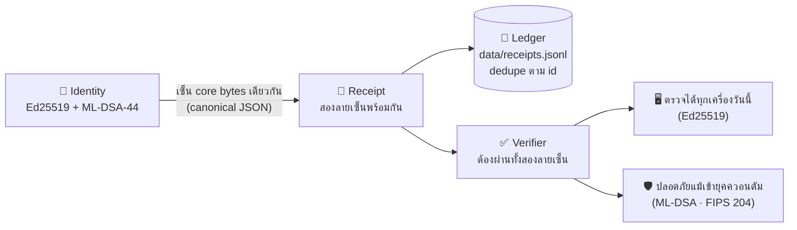

<div align="center">

### 🛡️ Sovereign PQ Identity
**POST-QUANTUM IDENTITY + DUAL-SIGNED RECEIPTS** — ตัวตนนิรนามที่ทำงานเครื่องใดก็ได้ **กุญแจเกิดและอยู่ในเครื่องคุณ · ตรวจได้ครบโดยไม่มีคลาวด์ทั้งชุด**

ร่วมกันแปลงสลิป/บันทึกออกเป็นลายเซ็น*สองชั้น* — **Ed25519** (ตรวจได้ทุกเครื่องวันนี้) + **ML-DSA-44 (FIPS 204)** (ลายเซ็นกันควอนตัมตามมาตรฐาน NIST) เครื่องอื่นตรวจย้อนได้เสมอ

[](https://nvlpubs.nist.gov/nistpubs/FIPS/NIST.FIPS.204.pdf)
[](.)
[](#-️-zk-snark-anonymous-proof-v12--พิสูจน์ว่าเป็นสมาชิกโดยไม่บอกว่าใคร)
[](#-ผลการทดสอบจากเครื่องจริง)
[](./package.json)

</div>

---

## ⚡ ติดตั้งและลองใน 2 นาที

```bash
git clone https://github.com/krisakornutama/sovereign-pq-identity.git
cd sovereign-pq-identity
npm install
node cli.js keygen "ชื่อเรียกเครื่อง"   # สร้างตัวตน + เก็บกุญแจใน Vault เข้ารหัส (ตั้ง passphrase ตอนถาม)
node cli.js demo        # จำลองขาย → ถอดกุญแจจาก vault → เซ็นสองลายเซ็น → ตรวจ → ลงคลัง
node cli.js selftest    # ทดสอบการบุกรุก 7 เคส (สลิป + vault)
npm test                # ชุดทดสอบเต็ม 21 เคส (ไม่ใช้เน็ต)

# ZK-SNARK (v1.2) — พิสูจน์ว่าเป็นสมาชิกกลุ่ม โดยไม่บอกว่าใคร
node cli.js zk enroll "กลุ่มซื้อฟาร์ม A"   # สมัครสมาชิก (กุญแจลับเข้า vault เข้ารหัสเท่านั้น)
node cli.js zk tree                        # รวมรากกลุ่ม → data/members_root.json
node cli.js zk prove "กลุ่มซื้อฟาร์ม A"    # สร้างใบพิสูจน์นิรนาม (nullifier กันใช้ซ้ำ)
node cli.js zk verify data/zk-receipt-<epoch>.json   # ฝั่งผู้ตรวจ: ใช้ vkey เท่านั้น ไม่แตะกุญแจ
```

**เอาต์พุตจริงตอนรัน `node cli.js demo` (คัดจากเครื่องที่สร้างระบบนี้เอง):**

```
สร้างใบเสร็จสาธิต + เซ็นสองลายเซ็นแล้ว
  ตัวตน     : sps_86889d83f2f32d7ef2a7  (sovereign.ed25519+ml_dsa44.v1)
  หมายเลขใบ: pqri_7f590bc1ae771ab6
  เวลา     : 2026-11-08T09:33:08.585Z
  ยอด      : ฿120.00
  บัญชีในเครื่อง: data/receipts.jsonl
  Ed25519   : ✓ ผ่าน
  ML-DSA-44 : ✓ ผ่าน
  สรุป      : ✓ ใบเสร็จถูกต้อง (ทั้งสองลายเซ็นตรวจผ่าน)
  (payload ทั้งหมดเป็นข้อมูลสาธิตในเครื่อง ไม่มีข้อมูลจริง)
```

---

## 💎 ทำอะไรได้บ้าง

| # | ระบบ | ทำหน้าที่อะไร |
|---|---|---|
| 🪪 | **ตัวตนนิรนาม (`sps_*`)** | สร้างคู่กุญแจ **Ed25519 + ML-DSA-44** แล้ว hash เป็นหมายเลขตัวตน (`sps_xxxx…`) — ไม่ผูกชื่อจริง อ้างธุรกรรมด้วยหมายเลขนี้เพียงอย่างเดียว |
| ✍️ | **ใบเสร็จสองลายเซ็น (`pqri_*`)** | bytes เดียวกันถูกเซ็นโดยกุญแจ 2 อัลกอริทึม — verify ต้องผ่าน **ทั้งคู่** ขาดตัวใดตัวหนึ่งถือว่าใบเสร็จไม่สมบูรณ์ |
| 🌐 | **ตรวจย้อนจากเครื่องอื่นได้** | bytes ที่ถูกเซ็นคือ canonical JSON (เรียงคีย์แบบเสถียร) — verifier อีกเครื่องคำนวณซ้ำแล้วได้ผลลัพธ์เดียวกันเสมอ |
| 💾 | **คลังใบเสร็จท้องถิ่น** | แฟ้ม JSONL + กันซ้ำตาม `id` (ยื่นใบเดิมซ้ำไม่เกิดรายการใหม่ — ระบบเดียวแบบ `sovereign-offgrid`) |
| 🔒 | **Domain separation** | ลายเซ็น ML-DSA ผูก context `"sovereign-pq-receipt/v1"` — ลายเซ็นจากระบบอื่นใช้ต่อในแฟ้มของระบบนี้ไม่ได้ |
| 🛡 | **Local Key Vault** | กุญแจ secret **ไม่เก็บ plaintext** — เก็บเป็น vault เข้ารหัส **Argon2id (RFC 9106) + AES-256-GCM** ถอดขึ้นหน่วยความจำเฉพาะตอนเซ็นสลิปเท่านั้น |
| 🕶️ | **ZK-SNARK ยอมรับกลุ่มโดยไม่รู้ว่าใคร (v1.2)** | พิสูจน์ "อยู่ในกลุ่มสมาชิก" ต่อ POS/ผู้ตรวจด้วย **Groth16 + Poseidon Merkle + nullifier** — ผู้ตรวจไม่เห็นทั้งกุญแจและตำแหน่งในต้นไม้ ตรวจด้วย **vkey ล้วน** และกันใช้สิทธิ์ซ้ำรายคนต่อรอบ |

---

## 🚀 วิธีใช้งานครบชุด

```bash
# 1) สร้างตัวตนของเครื่องคุณ (กุญแจเกิดในแฟ้ม data/identity.json)
node cli.js keygen "ชื่อเรียกเครื่องนี้อย่างเดียว"

# 2) ออกใบเสร็จจำลอง + ตรวจทันที (เห็นกระบวนการเต็ม)
node cli.js demo

# 3) ตรวจแฟ้มใบเสร็จไฟล์ใดก็ได้ (exit 0 เมื่อผ่านทั้งคู่ลายเซ็น)
node cli.js verify <แฟ้มใบเสร็จ.json>

# 4) อ่านคลังใบเสร็จในเครื่อง + ตรวจทีละใบ
node cli.js ledger
```

**ใช้เป็นไลบรารีจากโค้ดคุณเอง:**

```js
import { createIdentity } from './src/identity.js';
import { signReceipt, verifyReceipt } from './src/receipt.js';

const identity = createIdentity({ label: 'แม่ค้าที่ 1' });
const receipt = signReceipt(identity, { type: 'sale', total_thb: 210 });

// ใบเสร็จนี้ถูกเซ็นด้วย Ed25519 และ ML-DSA-44 — ใครถือแฟ้มก็ตรวจความจริงด้วยตัวเองได้
const v = verifyReceipt(receipt); // → { valid: true, ed25519: true, ml_dsa44: true }
```

**โครงใบเสร็จจริงในคลัง (ตัดความยาว base64 เพื่ออ่านง่าย — ความยาวในวงเล็บคือจำนวนจริง):**

```json
{
  "id": "pqri_7f590bc1ae771ab6",
  "issued_at": "2026-11-08T09:33:08.585Z",
  "payload": { "type": "sale", "demo": true, "total_thb": 120.0 },
  "alg_profile": "sovereign.ed25519+ml_dsa44.v1",
  "signatures": {
    "ed25519":  { "pk_b64": "…44 bytes SPKI (60 chars)", "sig_b64": "…64 bytes (88 chars)" },
    "ml_dsa44": { "pk_b64": "…1,312 bytes (1,750 chars)", "sig_b64": "…2,420 bytes (3,228 chars)" }
  }
}
```

---

## 🏛️ สถาปัตยกรรม — ทำไมต้อง "สองลายเซ็น"



**เหตุผลเชิงความเสี่ยง (Harvest-now-decrypt-later ที่มาคู่ใบเสร็จ):** สลิปที่เก็บไว้ยาว ๆ วันหนึ่งอาจถูกแกะ Ed25519 ได้ด้วยเครื่องควอนตัม — ถ้ายังใช้ลายเซ็นชั้นเดียว สลิปจะถูกปลอมแปลงภายหลังได้อย่างเงียบ ๆ ระบบสองลายเซ็นนี้จึงเป็นการเตือนความปลอดภัยตั้งแต่ต้นวันธุรกรรม — ทั้งยังตรวจย้อนระยะยาวได้เสมอ (ความยาวกุญแจตรงมาตรฐาน FIPS 204: pk = 1,312 bytes · sk = 2,560 bytes · sig = 2,420 bytes)

---

## 🔐 Local Key Vault — กุญแจไม่เก็บ plaintext อีกต่อไป

กุญแจ secret ถูกเข้ารหัสด้วย **Argon2id** (KDF กัน brute-force ตาม RFC 9106 · m=64 MiB t=3 p=1) → กุญแจ AES-256-GCM ปกป้องแฟ้ม vault — **passphrase ไม่ถูกเก็บที่ใดเลย** — ถอดกุญแจขึ้นหน่วยความจำชั่วคราวเฉพาะขณะเซ็นสลิปแล้วทิ้งพร้อมโปรแกรมปิด

```bash
# กรณีมีตัวตนแบบ plaintext เก่า (จาก v1.0) — migrate:
node cli.js vault create        # ย้ายกุญแจ → vault + ตรวจเปิดกลับก่อนสำเร็จ
node cli.js vault remove-plain   # ลบแฟ้ม plaintext (ตรวจว่า vault ยังเปิดได้ก่อนลบเสมอ)

# ทดสอบเปิด vault ได้จริง (ขึ้น public view เท่านั้น ไม่โชว์ secret)
node cli.js vault open
```

**เอาต์พุตจริงจากการ migrate บนเครื่องสร้างระบบ:**

```
$ node cli.js vault create
ย้ายกุญแจจากแฟ้ม plaintext → vault เข้ารหัส (แฟ้ม plaintext จะยังอยู่ จนสร้าง vault สำเร็จ)
✓ เตรียมเสร็จ: vault data/identity.vault.json ตรวจเปิดกลับผ่าน
  ✍ ต่อไป: ลบแฟ้ม plaintext เอง หรือ run: node cli.js vault remove-plain

$ node cli.js vault open
✓ เปิด vault ได้จริง (กุญแจอยู่ในหน่วยความจำเฉพาะกระบวนการนี้)
  ตัวตน : sps_86889d83f2f32d7ef2a7  ·  KDF: argon2id
  กุญแจ public: Ed25519 MCowBQYDK2Vw… / ML-DSA-44 Aq1AcVZ4+H8g…

$ node cli.js vault remove-plain
✓ ลบแฟ้ม plaintext แล้ว — กุญแจอยู่ใน vault เข้ารหัสเท่านั้น
```

**สิ่งพิสูจน์แล้วจากการทดสอบ 1 จุดดี ๆ:** หลังลบแฟ้ม plaintext ทิ้งแล้ว ใบเสร็จ**เก่า**ที่เคยเซ็นไว้ยังตรวจผ่าน ✓ ทุกใบ — เพราะกุญแจสาธารณะถูกฝังในตัวใบเสร็จเอง (ใครถือแฟ้มสลิปตรวจได้ตลอดอายุไฟล์ ไม่จำเป็นต้องถือกุญแจของผู้เซ็น)

> 💡 Automation ล้วน: กำหนด `SOVEREIGN_PASSPHRASE=...` (เฉพาะเซสชัน) แล้วคำสั่งทุกตัวไม่ถาม prompt — เหมาะ CI / สคริปต์เบื้องหลัง (ระวัง log แฟ้มประวัติคำสั่ง).

**ข้อแตกต่างตรวจสอบมาแล้วจากโค้ดจริง:**

- ปลอม payload แม้ 1 บิต → ทั้งสองลายเซ็นพังพร้อมกัน (bytes เดาไม่ได้)
- ลบลายเซ็น ML-DSA ออก → verify ปฏิเสธ (ไม่ยอมรับ Ed25519 เฉพาะ)
- สลับลายเซ็นจากใบอื่นมาแปะ → verify ปฏิเสธ (pk ต้องจับคู่ sk จริงของตัวเอง)
- เปลี่ยน `alg_profile` → canonical bytes เปลี่ยน → verify ปฏิเสธทันที

---

## 🕶️ ZK-SNARK Anonymous Proof (v1.2) — พิสูจน์ว่าเป็นสมาชิก โดยไม่บอกว่าใคร

รุ่น v1.2 เพิ่มระดับที่ลายเซ็นธรรมดาทำไม่ได้: ยืนยันต่อ POS/ผู้ตรวจว่า **"ผู้ถือสิทธิ์อยู่ในกลุ่มสมาชิกที่ลงทะเบียนไว้"** — โดยไม่เปิดเผยกุญแจ ไม่เปิดเผยตำแหน่งในต้นไม้สมาชิก และไม่เกิดการใช้สิทธิ์ซ้ำ

**วงจรจริง:** `circuits/membership.circom` — Groth16 บนเส้นโค้ง **BN254** · แฮชแผนผังทั้งหมดด้วย **Poseidon**(circomlib — SNARK-friendly) · ความลึก D=4 → ความจุ 16 สมาชิก · คอมไพล์จาก circom 2.2.3 → **1,592 non-linear + 2,054 linear constraints**

| ตัวแปรของวงจร | ฝั่งจากใคร | ผู้ตรวจเห็นได้เหลือเกิน |
|---|---|---|
| `identitySecret` · `pathElements[4]` · `pathIndices[4]` | **private** — อยู่ในหน่วยความจำเครื่องผู้พิสูจน์เท่านั้น | ✗ ไม่เห็นเลย |
| `merkleRoot` (รากทะเบียนกุมสิทธิ์) · `epochNonce` (หมายเลขรอบ กัน replay) | **public input** | ✓ เห็น |
| `nullifierHash` = Poseidon(`identitySecret`, `epochNonce`, TAG_NULL) | **output สาธารณะ** | ✓ เห็น — รู้ว่า "สิทธิถูกใช้แล้ว" แต่ไม่รู้ว่าใคร |

การแยกหน้าที่ชัดกันทุกขั้นด้วยแท็กโดเมน (LEAF / NODE / NULL) — แฮชจากขั้นหนึ่งถ่ายไปแทนอีกขั้นไม่ได้ · **nullifier ทำหน้าที่กัน double-claim**: ใบเดียวกันในรอบเดียวกัน (epoch) ยื่นซ้ำจะถูกจากคลัง nullifier ฝั่งผู้ตรวจ

**เอาต์พุตจริงจาก CLI บนเครื่องสร้างระบบ (กระบวนการครบวงจร):**

```
$ node cli.js zk enroll "กลุ่มซื้อฟาร์ม A"
✓ คลังสมาชิกสร้างใหม่ (เข้ารหัสแบบเดียวกับกุญแจตัวตน: Argon2id + AES-256-GCM)
✓ ลงทะเบียนสมาชิก "กลุ่มซื้อฟาร์ม A" สำเร็จ (อันดับ 0)
  commitment (สาธารณะ): 0x260144f1c5a70db9a035…
  (กุญแจลับอยู่ใน data/membership.vault.json — แฟ้มทะเบียนไม่มีข้อมูลลับ)

$ node cli.js zk tree
✓ รากสมาชิก (merkleRoot): 0xd5a49d1c5d9a69affd9a2e63…
  สมาชิก 2 จากความจุสูงสุด 16 (ช่องว่างเติมด้วยค่า 0 ครบทุกชั้น …)

$ node cli.js zk prove "กลุ่มซื้อฟาร์ม B"
พิสูจน์นิรนาม (กุญแจลับอยู่ในหน่วยความจำระหว่างคำนวณเท่านั้น)…
✓ พิสูจน์สำเร็จ → data/zk-receipt-20261109.json
  ใบพิสูจน์  : pqri_anon_255f9900  ·  epoch: 20261109
  nullifier : 0x255f99001e8e1dcc…  (ผู้ตรวจบันทึกไว้กันซ้ำ — ไม่ออกตัวตน)
  ราก       : 0xd5a49d1c5d9a69af…

$ node cli.js zk verify data/zk-receipt-20261109.json
✓ ใบพิสูจน์ถูกต้อง (vkey ตรวจผ่าน · กุญแจเจ้าของไม่ถูกเปิดเผย)
  nullifier : 0x255f99001e8e1dcc…  → บันทึกกันซ้ำแล้ว (0 รายการ)
  margin: ใบเดียวกันรอบเดียวกันใช้ซ้ำไม่ได้อีก — epoch ใหม่คือสิทธิ์ใหม่

$ node cli.js zk verify data/zk-receipt-20261109.json     # ยื่นซ้ำ
✗ สิทธิ์รอบนี้ถูกใช้ไปแล้ว (nullifier ซ้ำ) — ปฏิเสธแม้ proof ยังถูกต้องตามวงจร   (exit 1)
```

**ขั้นพิสูจน์จริงที่ไม่มีข้อมูลจำลอง:** prove โดยไม่มีกุญแจจาก vault ไม่ได้ผล (CLI ตรวจซ้ำว่า hash ของกุญแจ secret ตรง commitment ที่ลงทะเบียนไว้ก่อนลงมือพิสูจน์เสมอ) · แก้ `pi_c` 1 ค่า → verify false · กุญแจปลอม → วงจรปฏิเสธตั้งแต่ทำ witness · ตรวจย้อนข้ามเครื่องทั่วไปด้วยคำสั่งมาตรฐาน: `npx snarkjs groth16 verify artifacts/membership_vkey.json <public.json> <proof.json>` → `OK!`

**การใช้แฟ้มวงจร**: ชุดที่ใช้แล้วบันทึกไว้ใน `artifacts/` ทั้งหมด (**`membership.wasm` 1.86 MB · `membership.zkey` 1.50 MB · `membership_vkey.json` 3.2 KB**) — ฝั่งผู้พิสูจน์ใช้ wasm+zkey ฝั่งผู้ตรวจต้องมี **vkey เท่านั้น** (ไม่ต้องมี zkey ไม่ต้องมีกุญแจสมาชิก)

### การสร้างแฟ้มวงจร (เมื่อต้องการออกวงจรใหม่หรือกลุ่มใหญ่ขึ้น — ทำครั้งเดียวต่อวงจร)

```bash
# คอมไพล์วงจร (circom v2.2.3 — ดาวน์โหลด binary จาก release ของ iden3/circom ไว้ .tools/)
.tools/circom.exe circuits/membership.circom --wasm --r1cs -o build -l node_modules

# Powers of Tau + Groth16 setup — entropy มาจากตัวเครื่องเราเองทั้งหมด (ไม่โหลดจากที่ไหน)
npx snarkjs powersoftau new bn128 14 build/pot14_0000.ptau -v
npx snarkjs powersoftau contribute build/pot14_0000.ptau build/pot14_0001.ptau --name="local" -v -e="<ข้อความสุ่มยาวของเครื่องนี้ — ไหมทำเป็นหมายเลขประจำตัวที่จดไว้/เปิดเผย>"
npx snarkjs powersoftau prepare phase2 build/pot14_0001.ptau build/pot14_final.ptau -v
npx snarkjs powersoftau verify build/pot14_final.ptau               # → "Powers of Tau Ok!"
npx snarkjs groth16 setup build/membership.r1cs build/pot14_final.ptau build/membership_0000.zkey
npx snarkjs zkey contribute build/membership_0000.zkey build/membership_final.zkey --name="local" -v -e="<ข้อความสุ่มอีกชุด>"
npx snarkjs zkey verify build/membership.r1cs build/pot14_final.ptau build/membership_final.zkey   # → "ZKey Ok!"
npx snarkjs zkey export verificationkey build/membership_final.zkey artifacts/membership_vkey.json

# ทำแฟ้มให้ artifacts/ (ผู้ตรวจถูกต้องด้วย vkey; ใน repo นี้แนบชุดให้แล้ว)
cp build/membership_js/membership.wasm artifacts/membership.wasm
cp build/membership_final.zkey artifacts/membership.zkey
```

### ข้อจำกัดที่ควรรู้ก่อนพาไปใช้จริง (ตามความจริง)

- ⚙️ **Trusted setup ครั้งเดียวแบบฝ่ายเดียว** — powersoftau/zkey ของ repo นี้สร้างในเครื่องเดียว (entropy ในเครื่องล้วน) ทุกเครื่องตรวจได้เพราะมี vkey กับรากเดียวกัน แต่การเชื่อว่า zkey ไม่มี "ปีกความรู้ข้างเครื่องสร้าง" คือความเชื่อมั่นที่พึงถือเครื่องสร้าง; สำหรับระบบสาธารณะเต็มจริงแค่บัญชีส่วนท้ายต้องทำ ceremony หลายฝ่าย — นี่คือจุดแชร์เปิดศักดิ์สิทธิ์อย่างตรงไปตรงมา
- 🧮 **ความจุกลุ่ม 16 สมาชิกต่อใบราก** (D=4) — กลุ่มใหญ่ขึ้นต้องออกวงจรลึกขึ้น (D=5 → 32 คน) และ generate/setup ใหม่ทั้งชุด; ช่องว่างใบตองด้วย 0 — ปลอมพิสูจน์ด้วยช่องว่างไม่ได้เพราะวงจรสร้าง leaf จาก `identitySecret` ตลอด (หักหลังกลับค่า 0 ผ่าน hash preimage ถือว่าไม่เอาอย่างเข้มขัดกว่าการปลอมกุญแจแบบทั่วไป) 
- 📅 **1 คน = 1 สิทธิ์ / 1 epoch** — คลัง nullifier ที่ `data/nullifiers.jsonl` เก็บฝั่งผู้ตรวจ (ลำดับ event log) · ยากแต่ควรเป็นอนัมภัย: ผู้ตรวจควร pin แฟ้มรากตามวัน (`data/members_root.json มี`generated_at`) — รากใหม่เมื่อกลุ่มเปลี่ยน· สิทธิ์ใบแถวยังตรวจกับรากตาม epoch ที่ประกาศไว้อย่างเห็น
- 🐢 **snarkjs คืน worker ไว้ใน event loop** — หลัง prove/verify จริงเนื่องภายในไฟล์ต่อเนื่องจะยังย่านว่าถึงกระบวนจบเร็ว ๆ แต่ในขั้นของ "ชุดลงทุนทดสอบ" รวม `npm test` รันด้วย `--test-force-exit` (built-in Node ≥22.8) เพื่อบังคับจบให้ผลครบ — หลักเตลิดตามทุกคำสั่ง CLI ที่ทำงาน prove/verify สั่ง `process.exit()` หลังเขียนแฟ้มเสร็จ

---

## ✅ ผลการทดสอบจากเครื่องจริง

```
$ npm test
✔ canonical เรียงคีย์ได้เสถียร (bytes เดียวทุกเครื่อง)
✔ ยืนยันตัวตน Ed25519 + ML-DSA-44 ทั้งคู่
✔ เซ็นใบเสร็จ → ตรวจผ่านทั้งสองลายเซ็น
✔ ปลอมแปลง payload 1 บิต → ทั้งสองลายเซ็นต้องพัง
✔ ตัดลายเซ็น ML-DSA ออก → ระบบไม่ตอบรับ
✔ เอาลายเซ็นมาจากใบอื่นมาแปะ → ไม่ผ่าน
✔ id/issued_at อยู่ใน core bytes ที่เซ็น และลายเซ็นไม่หลุดเข้าฟีเจอร์เอง
✔ context ต้องตรงเดิมเป๊ะ (โดเมนแยก) → ML-DSA verify ไม่ผ่าน
✔ vault: ตัวตนเข้ารหัส→ถอดรหัสกลับได้ตรงกัน
✔ vault: passphrase ผิด → ปฏิเสธ (ไม่เงียบเฉย)
✔ vault: แฟ้มถูกแก้ 1 บิต (ciphertext) → authTag ตรวจไม่ผ่าน
✔ vault: ต้องมีพารามิเตอร์ Argon2id ในแฟ้ม (ตรวจสอบได้ตลอดอายุแฟ้ม)
✔ vault → signReceipt: ถอดกุญแจจาก vault แล้วเซ็นได้ + ตรวจผ่านทั้งคู่
✔ vault: passphrase สั้นเกิน 8 ตัว → ปฏิเสธตั้งแต่ตอนสร้าง
✔ merkle: ลำดับใบต่างกัน → รากต้องต่างกัน (canonical เสถียร)
✔ merkle: สมาชิกน้อยกว่าความจุ → padding เต็มช่องและรากยังเสถียร
✔ merkle: รากจากเส้นทาง member#2 ไต่ขึ้นเทียบรากตรงกัน (indices เป็นบิตจริง)
✔ zk: พิสูจน์สมาชิกจริง → ตรวจผ่านโดยไม่รู้กุญแจ (วงจรจริง)
✔ zk: แก้ proof 1 บิต → ตรวจไม่ผ่าน
✔ zk: สมาชิกที่ไม่อยู่ในกลุ่ม → วงจรปฏิเสธที่ witness (ไม่มี proof ออกมา)
✔ zk: nullifier เดียวกันใช้ซ้ำรอบเดียวกัน = ตรวจพบ (double-claim)

ℹ tests 21 · pass 21 · fail 0 · duration 4.3 s
```

```
$ node cli.js selftest
  ✓ เซ็นแล้วตรวจผ่าน (ทั้งสองลายเซ็น)
  ✓ แก้ payload → ต้องไม่ผ่าน
  ✓ ลบลายเซ็น ML-DSA → ต้องไม่ผ่าน
  ✓ ลายเซ็น Ed25519 ตรวจแยกขั้น
  ✓ ลายเซ็น ML-DSA-44 ตรวจแยกขั้น
  ✓ vault: เข้ารหัส→ถอดรหัส กลับได้ตรง
  ✓ vault: passphrase ผิด → ต้องปฏิเสธ
```

---

## 🏢 อยู่ตรงไหนในผังระบบ Sovereign

repo นี้คือ**ชั้นตรวจสอบอัตลักษณ์**ที่วางแผนเพื่อต่อกับโครงอื่นทั้งชุด — แทนที่จะแตะระบบเดิมโดยตรง มันทำงานเป็น**ไลบรารีเดี่ยว ๆ** แล้วคุณเลือกเวลาต่อยอดได้เองในอนาคต

| โปรเจกต์ | ความสัมพันธ์ |
|---|---|
| 🏠 [`sovereign-origin`](https://github.com/krisakornutama/sovereign-origin) — **ระบบหลัก** | แอป desktop ประจำบ้าน (ขาย · บัญชี · ภาษี · ฟาร์ม) — อนาคตรับ ledger จาก repo นี้ไป export เป็นเอกสารทางบัญชี |
| 🌿 [`sovereign-offgrid`](https://github.com/krisakornutama/sovereign-offgrid) | POS ออฟไลน์เซ็น Ed25519 แล้ววันนี้ — ไลบรารีของ repo นี้นำไป**อัปเกรดสลิปเป็นสองลายเซ็นตั้งแต่ต้นทาง**ได้เลย |
| 📡 [`project-sovereign`](https://github.com/krisakornutama/project-sovereign) | เว็บสาธารณะ + ระบบหลังบ้าน self-hosted — โครงพื้นฐานที่เชื่อมทุก repo |
| 🧠 [`sovereign-rule-engine`](https://github.com/krisakornutama/sovereign-rule-engine) | Rule engine Merkle + CRDT — ใช้ตัวตน/ลายเซ็นจาก repo นี้ตั้งกฎสิทธิ์ได้โดยตรง |

---

## 🧭 โรดแม็ปตามชั้นเป้าหมายจริง

| เฟส | งาน | สถานะ |
|---|---|---|
| ✅ **v1.0–v1.1** | ตัวตนนิรนาม + สองลายเซ็น (Ed25519 + ML-DSA-44) + คลัง idempotent + **Local Key Vault (Argon2id + AES-256-GCM)** | พร้อมใช้ |
| ✅ **v1.2 — บังเกตุจากเครื่องจริง** | **ZK-SNARK Anonymous Membership** — วงจรจริง Groth16 (Poseidon Merkle + nullifier กันใช้ซ้ำ) · CLI `zk enroll/list/tree/prove/verify` · ตรวจด้วย vkey ล้วน · 21/21 ทดสอบ | พร้อมใช้ |
| 🧩 **เฟสถัดไป** | **Balance Threshold Proof** — พิสูจน์ว่ายอด/สิทธิ์เพียงพอโดยไม่เผยตัวเลขจริง (ต่อยอดวงจรเดียวกัน) | วางแผน |
| 🧊 **เฟส 3** | ลายเซ็นชุดเสริม (SLH-DSA / Falcon) + ระบบหมุนเวียนกุญแจอัตโนมัติ | วางแผน |
| 🔊 **เฟส 4** | เข้ารหัสแบบด้าน ML-KEM (FIPS 203) สำหรับแฟ้มที่ส่งระหว่างโหนด | วางแผน |

---

## ⚠️ ความจริงระยะตรง — อ่านก่อนใช้จริง

- 🔏 **กุญแจ secret เก็บใน vault เข้ารหัสตั้งแต่ v1.1** — หากยังใช้แฟ้ม plaintext เก่า (v1.0) ให้ migrate ด้วย `node cli.js vault create` ตามด้วย `vault remove-plain` ทันที — ระบบขอ passphrase แบบพิมพ์ซ่อนอักษร · **ลืม passphrase = ไม่มีทางกู้คืนกุญแจ** (ตามหลัก vault: กุญแจเสีย ตัวตนต้องสร้างใหม่) ทางต่อยอดถัดไป: เชื่อม OS keychain (macOS Keychain / Windows DPAPI / Linux Secret Service)
- 🕶️ **ระดับ ZK-SNARK (v1.2)** — กุญแจลับสมาชิกอยู่ใน vault เข้ารหัสแยกชุดเดียวกัน (`data/membership.vault.json` · passphrase แยกต่างจากตัวตน) · trusted setup สร้างแน่ในเครื่องเดียวและกลุ่มจำกัด 16 สมาชิกต่อราก — รายละเอียดข้อจำกัดฉบับเต็มอยู่ในหัวข้อ ZK ข้างบน; แฟ้มทะเบียนสมาชิกที่ส่งผู้ตรวจ (`members.json` + `members_root.json`) **ไม่มีข้อมูลลับใด ๆ**
- 🌐 **บนเบราว์เซอร์ (Web Crypto) ยังไม่รองรับ ML-DSA** — ระบบนี้วิ่งบน Node.js เป็นหลัก ส่วนฝั่งเบราว์เซอร์จะต้องใส่ไลบรารี JS/WASM อีกชั้น (จะเพิ่มเป็นเวอร์ชันเสริม)
- 🧪 **สำหรับภารกิจระดับธนาคาร/การแพทย์** — โค้ดระบบนี้เป็นระบบนำพิสูจน์แนวทาง; ก่อนนำไปใช้ระดับ production จริง ควรให้ผู้เชี่ยวชาญตรวจโค้ด (code audit) หรือใช้ liboqs เวอร์ชันที่ผ่านการตรวจแทน
- 🧾 ทุกชิ้นรันในเครื่อง · **ไม่ส่งข้อมูลจากเครื่องออกไปที่ไหน** — `npm install` ต้องเน็ตครั้งเดียวตอนติดตั้ง; หลังจากนั้นระบบทำงาน offline 100%

---

## 👤 ผู้พัฒนา

**กฤษกรณ์ อุตมะ (Krisakorn Utama)** — System Architect
> ออกแบบและพัฒนาระบบ Electron / Next.js + Node.js ทั้งชุด — ข้อมูลทุกชุดรออยู่ในเครื่องของคุณเอง ตามหลัก sovereignty
> แผนการพัฒนาทั้งหมดดูได้ที่ [project-sovereign](https://github.com/krisakornutama/project-sovereign)

<div align="center">

**⭐ ถ้าระบบนี้ช่วยงานคุณได้ กด Star เป็นกำลังใจให้การพัฒนา 🫶**

</div>
